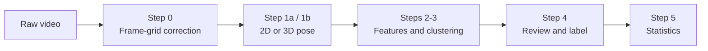

<div align="center">


# CUBE

**Multi-camera video → 2D/3D pose → unsupervised behaviour clusters → group statistics.**


</div>

**CUBE v5** (Comprehensive Unsupervised Behavioral Explorer) is an open-source, point-and-click pipeline for unsupervised discovery and quantification of animal behaviour from DeepLabCut pose estimation. It turns raw behavioural video into discrete behaviour clusters and group-level statistics without hand-labelling, in 2D or with multi-camera 3D pose. CUBE builds on the approach introduced by B-SOiD (Hsu & Yttri 2021) and adds multi-scale features, cluster validation, temporal smoothing, interactive annotation and a statistics suite.



## 📖 Full guide

Methods, every parameter (defaults, suggested values, direction of effect), recipes and troubleshooting are in the guide:

- **[Project website](https://param-valiathan.github.io/CUBE-site/)**: quick start, guide, gallery and an overview video
- **[docs/CUBE_Guide.md](docs/CUBE_Guide.md)** (readable online)
- **[docs/CUBE_Guide.docx](docs/CUBE_Guide.docx)** (Word download)

## ⚙️ Install and run

Windows, NVIDIA GPU recommended for pose inference.

```bat
conda env create -f environment.yml
conda activate CUBE
python cube.py
```

> [!TIP]
> For GPU inference, install a CUDA build of PyTorch from pytorch.org before the `deeplabcut` package, and check with `python -c "import torch; print(torch.cuda.is_available())"`.

## 🗂️ Repository layout

| Path | Contents |
|------|----------|
| `cube.py` | Main window and the six-step pipeline |
| `cube_core.py` | Engine: features, clustering, classifier, HMM, triangulation |
| `cube_3d_dlc.py`, `calibrate_cameras.py`, `calibration_refine_poses.py`, `cube_homography_calibrator.py` | Step 1b: 3D pose and calibration |
| `bonsai_video_corrector.py` | Step 0: Bonsai / Doric video correction |
| `cube_video_explorer.py`, `guided/` | Step 4: cluster review and guided labelling |
| `cube_analyser.py` | Step 5: group statistics and paradigm readouts |
| `docs/` | The user guide |
| `environment.yml` | Conda environment |

## 📚 Credits and citation

CUBE was developed by Param Valiathan in the laboratory of Patrik Ernfors at Karolinska Institutet ([research group](https://ki.se/en/mbb/research-division-of-molecular-neurobiology)). A preprint is in preparation; until it appears, please cite the software:

> Valiathan P. CUBE: Comprehensive Unsupervised Behavioral Explorer, version 5. Developed in the laboratory of Patrik Ernfors, Karolinska Institutet. https://github.com/param-valiathan/CUBE

Please also cite the work CUBE builds on: B-SOiD (Hsu & Yttri 2021, *Nat. Commun.* 12:5188), DeepLabCut (Mathis et al. 2018, *Nat. Neurosci.* 21:1281), UMAP (McInnes et al. 2018, arXiv:1802.03426), HDBSCAN (McInnes et al. 2017, *JOSS* 2:205) and, for 3D mode, Anipose (Karashchuk et al. 2021, *Cell Rep.* 36:109730).

Until the preprint is released, CUBE is provided under the [CUBE Pre-publication Source-Available Licence](LICENSE): you may read the code and run unmodified copies for personal, non-commercial evaluation and academic research, with attribution. Redistribution, modification for distribution, derivative software and commercial use need the author's prior written permission. The licence is intended to be replaced by an open-source licence when the preprint appears.
