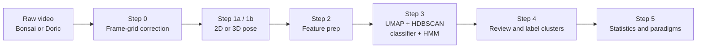
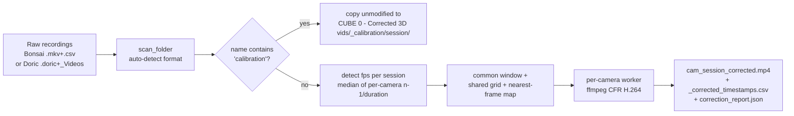
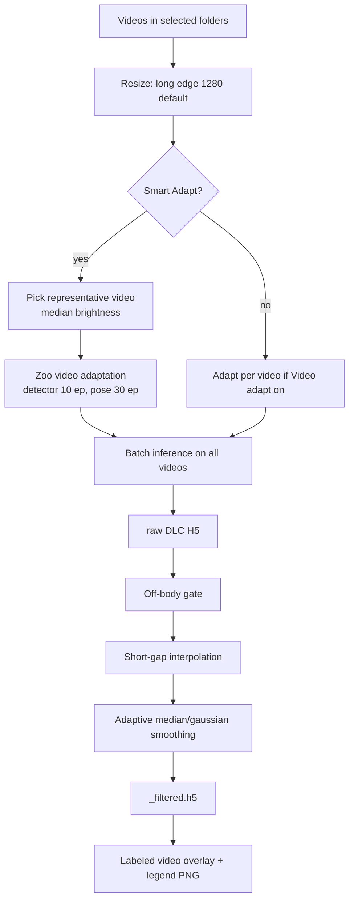
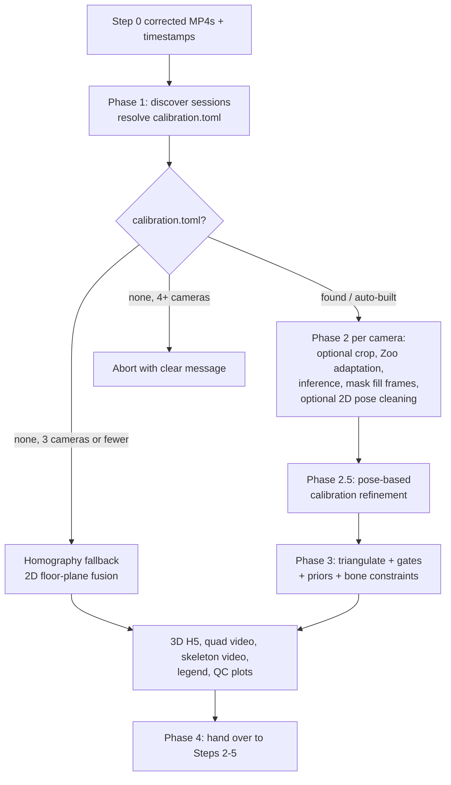
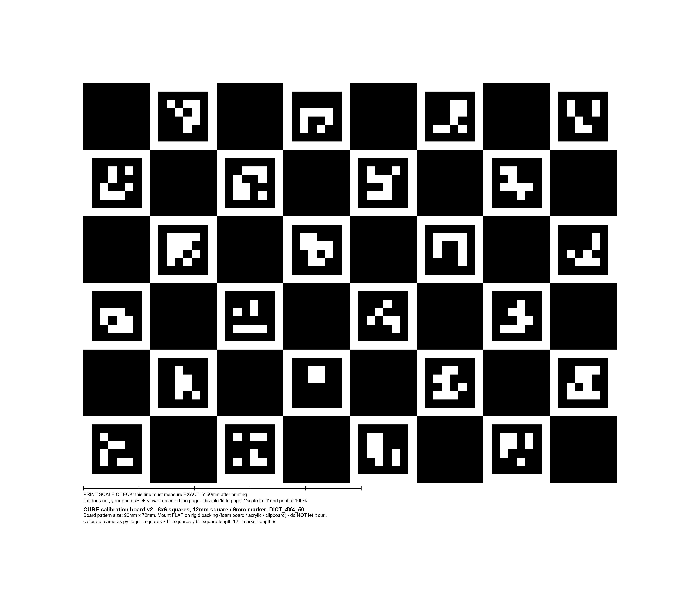
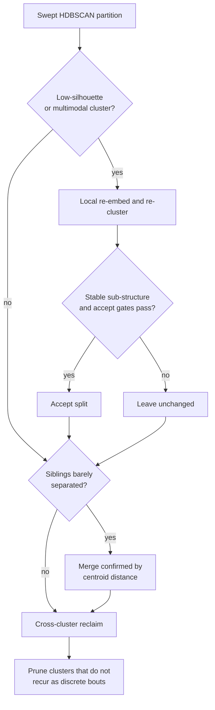
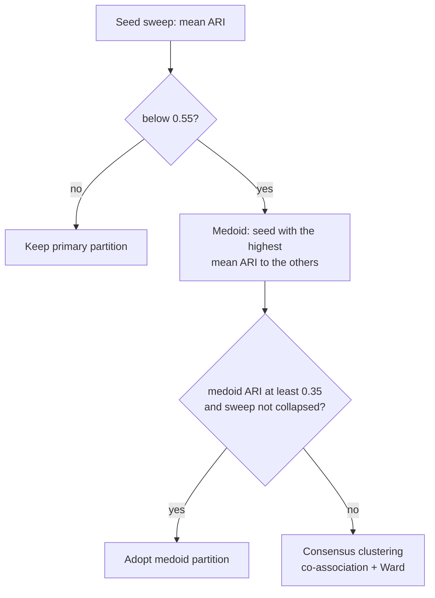
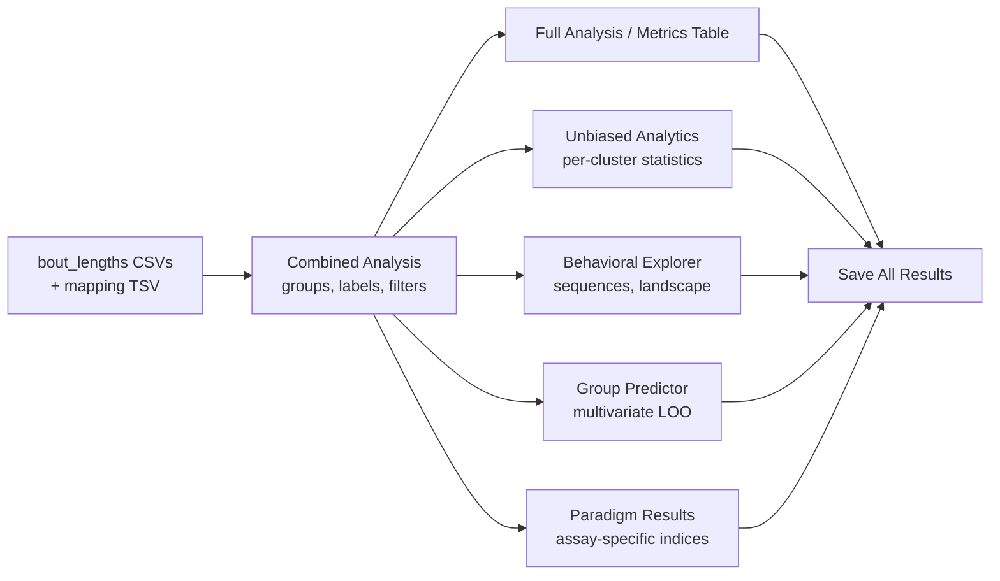

<div align="center">


# CUBE : Comprehensive Unsupervised Behavioral Explorer

**From multi-camera video to 3D pose to unsupervised behaviour clusters to group statistics.**


</div>

> [!NOTE]
> This guide is complete. Each section explains **what a step computes and why**, then lists its tunable parameters with a code-verified default, suggested values, and the direction in which each setting moves the result.

## 🧭 Contents

- [Step 0 — Multi-Camera Video Correction (bonsai_video_corrector.py)](#step-0-multi-camera-video-correction-bonsai-video-corrector-py)
- [Step 1a — 2D Pose Estimation (DeepLabCut SuperAnimal)](#step-1a-2d-pose-estimation-deeplabcut-superanimal)
- [Step 1b — 3D Pose: Calibration, Triangulation and Clean-up](#step-1b-3d-pose-calibration-triangulation-and-clean-up)
- [Step 4 — Video Explorer and Guided Labelling](#step-4-video-explorer-and-guided-labelling)
- [Step 5 — Behaviour Analyser (cube_analyser.py)](#step-5-behaviour-analyser-cube-analyser-py)
- [Output Layout and File Reference](#output-layout-and-file-reference)
- [Python Module Reference](#python-module-reference)
- [Recipes](#recipes)
- [Troubleshooting](#troubleshooting)

## 🔭 Overview

CUBE turns raw behavioural video into discrete, interpretable behaviour clusters and group-level statistics without hand-labelling.



| Step | Purpose | Main module |
|------|---------|-------------|
| 0 | Synchronise multi-camera recordings onto one constant-fps frame grid | `bonsai_video_corrector.py` |
| 1a | Single-camera 2D keypoints (SuperAnimal-Quadruped) | `cube.py`, `cube_core.py` |
| 1b | Multi-camera calibration and 3D triangulation | `cube_3d_dlc.py`, `calibrate_cameras.py` |
| 2-3 | Feature extraction, embedding, clustering, frame classifier, temporal smoothing | `cube_core.py` (`BSoidEngine`) |
| 4 | Inspect clusters as video clips, name behaviours | `cube_video_explorer.py`, `guided/` |
| 5 | Group comparisons, transitions, paradigm readouts | `cube_analyser.py` |

Steps are launched from the main window (`cube.py`) and can be chained. Every stage writes its result to disk and **skips work that already exists**, so an interrupted run resumes where it stopped.

### How CUBE relates to other tools

CUBE builds on B-SOiD and sits alongside other well-validated tools such as VAME and keypoint-MoSeq. These tools were designed for different needs, and none is best in every setting. The points below describe where CUBE's design differs. They reflect design choices rather than measured differences in performance. CUBE is under active development, and suggestions are very welcome.

**Where CUBE's design differs**

1. **A single application from recording to figures.** Video alignment, pose estimation, pre-processing, clustering, annotation and statistics are run from one point-and-click interface, so a complete analysis does not require programming or moving files between separate programs. Every stage of a run is saved to one folder.
2. **Temporally aware, animal-centred clustering with a reproducibility check.** Features describe posture and movement in animal-centred (egocentric) coordinates together with the order of movements. Clustering is repeated across random seeds and the agreement between runs is reported. When agreement is low, CUBE builds a representative (medoid) or consensus partition, so that the result depends less on a single seed.
3. **Researcher-guided refinement and correction.** Clusters are named by watching example clips, and can be merged, split or recombined by hand, with a dendrogram view to support the decision. Optional guided labelling lets you supply your own labelled examples, so manual input remains possible at each stage rather than only at the end.
4. **Built-in analysis and figures.** The analyser produces ethograms, bout statistics, bar charts, transition analyses and group comparisons that highlight clusters whose usage changes between conditions, including behaviours that were not defined in advance. A Group Predictor, based on regularised logistic regression (a generalised linear model) with permutation testing, asks whether behavioural profiles distinguish the groups.
5. **Arena-aware clustering.** Optionally, clustering can take the position of the animal in traced regions of the arena into account, such as the open arms of an elevated plus maze, so that spatial context can help separate behaviours without letting position replace movement as the classification signal.

**Related tools**

- **B-SOiD** (Hsu and Yttri 2021) introduced the pose-feature, UMAP, HDBSCAN and fast-classifier approach that CUBE follows. CUBE keeps its speed and its lack of GPU training.
- **VAME** (Luxem et al. 2022) learns a temporal embedding with a neural network. CUBE does not adopt that architecture or its training cost, and uses temporally aware features and smoothing to address a related question by simpler means.
- **keypoint-MoSeq** (Weinreb et al. 2024) models keypoint uncertainty explicitly. CUBE uses a simpler analogue, in which low per-body-part confidence is used as a feature so that unreliable frames can be separated from behaviour clusters.

## ⚙️ Installation and launch

CUBE targets Windows with an NVIDIA GPU (pose inference only; clustering runs on CPU).

```bat
conda env create -f environment.yml
conda activate CUBE
python cube.py
```

> [!TIP]
> For GPU pose inference, install a CUDA build of PyTorch from pytorch.org **before** creating the environment's `deeplabcut` package, then verify with `python -c "import torch; print(torch.cuda.is_available())"`.

Verify the install:

```bat
python -c "import cv2, customtkinter, imageio_ffmpeg, aniposelib, h5py, deeplabcut, hdbscan, umap; print('OK')"
```

Standalone entry points (each is also reachable from the main window):

| Command | Tool |
|---------|------|
| `python cube.py` | Main six-step pipeline |
| `python bonsai_video_corrector.py` | Step 0 on its own |
| `python cube_analyser.py` | Step 5 on an existing results folder |
| `python cube_video_explorer.py` | Step 4 on an existing results folder |
| `python calibrate_cameras.py --help` | Build `calibration.toml` from a calibration recording |

The window theme (`dark` or `light`) is stored in `theme.txt`, written when you toggle the theme in the GUI.

<a id="step-0-multi-camera-video-correction-bonsai-video-corrector-py"></a>

## 🎞️ Step 0 — Multi-Camera Video Correction (`bonsai_video_corrector.py`)

Step 0 turns raw multi-camera recordings, whose cameras each have their own jittery frame timestamps, into videos that are **frame-for-frame comparable across cameras**. Every later 3D step assumes that frame *k* of `cam0` and frame *k* of `cam1` were captured at the same instant. Raw recordings rarely satisfy this. Cameras drop frames, start a few milliseconds apart, and run at slightly different real frame rates.

> [!NOTE]
> Step 0 is a standalone window (`python bonsai_video_corrector.py`). It is **required for 3D** and optional for single-camera 2D work. When a selected source folder holds raw recordings with no `*_corrected.mp4`, Step 1b can launch it for you (`dlc_3d_autorun_step0 = True`). The window opens pre-filled and pre-scanned, and you still review the session list and click **Run**.

### 🧠 Scientific logic

1. **Read a timestamp for every frame.** The video container's own timing is not trusted. Each frame's true capture time comes from the acquisition software's log.
2. **Find the common time window.** `common_start = max(first timestamp over cameras)` and `common_end = min(last timestamp over cameras)`. Only the interval during which *all* cameras were recording is kept.
3. **Build one shared constant-rate grid.** The grid has `round((common_end − common_start) · fps) + 1` slots, spaced `1/fps` apart. The same grid is used for every camera, so frame *k* means the same instant everywhere.
4. **Map each grid slot to the nearest source frame.** A monotonic forward scan (O(N), never seeks backwards) picks the source frame closest in time.
5. **Mark fills.** If the nearest source frame is more than **½ frame period** (`0.5/fps`) from the grid time, the slot has no genuine frame. The previous frame is duplicated and the slot is flagged `fill = 1` in the timestamps CSV.
6. **Encode a constant-frame-rate MP4** (`-vsync cfr`, `yuv420p`, `+faststart`). DeepLabCut and the triangulation stage expect constant fps.

> [!IMPORTANT]
> Fill frames are *duplicates*, not data. Their pose is a copy of the previous frame. Step 1b reads the `fill` column and zeroes the likelihood of those frames, so they never contribute to triangulation. Typical failure mode: a camera that drops many frames produces many fills, and the 3D track then has gaps at exactly those times.



### 📥 Supported inputs (auto-detected together)

| Format | Recognised by | Timestamp source |
|---|---|---|
| **Bonsai** | `.mkv` plus a same-stem `.csv` whose first line is `ToString("o")` | ISO-8601 lines in the CSV |
| **Doric Neuroscience Studio** | `{stem}.doric` (HDF5) beside a `{stem}_Videos\` folder | `Time` datasets inside the `.doric` file (`.../Video/Series*/<serial>/Time`, float64 seconds) |

- **Bonsai naming:** `cam0_30fps<rest>.csv` gives `cam_label = cam0` and `session_id = 30fps<rest>`. Otherwise `cam<N><rest>` is used. Cameras that share a `session_id` are grouped into one session.
- **Doric video resolution:** the parent (serial) group's `RelativeFilePath` attribute names the exact video file, relative to the `.doric` file. No filename guessing is involved.
- **Doric camera labels:** serial numbers are sorted globally across *every* valid `.doric` file under the scanned root, then labelled `cam0, cam1, …`. A physical camera therefore keeps the same label in every session, even if a session recorded only a subset of cameras. This works for any camera count.
- **Skipped files:** `*incomplete*.doric` files are never used as a timestamp source. If `h5py` is missing, discovery silently degrades to Bonsai-only.
- **Calibration sessions:** any session whose `session_id` contains `calibration` (case-insensitive, either format) is **not corrected**. Its raw videos (`camN_`-prefixed) and the parent `.doric` or `.csv` are copied into `…/CUBE 0 - Corrected 3D vids/_calibration/{session_id}/`, one subfolder per session. Step 1b auto-calibration looks for exactly this layout.

### 🔧 Parameters

| Parameter (GUI field) | Default | Raising it | Lowering it | Typical values | Risk |
|---|---|---|---|---|---|
| **Frame rate** | auto per session (`detect_session_fps`: median over cameras of `(n_frames−1)/duration`, rounded to a whole number) | not user-set | not user-set | 15 / 24 / 30 / 60 | 🟢 |
| **CRF** (quality) | `23` | smaller files, more compression artefacts | larger files, cleaner frames | 18 (archival), 23 (default), 28 (quick look) | 🟢 |
| **Drop threshold (ms)** | `50` | fewer inter-frame gaps reported as drops | more gaps reported | 35 ms for 30 fps rigs that must report every missed frame | 🟢 |
| **Encoder** | auto-probed in order `h264_nvenc` → `h264_qsv` → `libx264` | n/a | n/a | pick `libx264` if a GPU encoder gives artefacts | 🟢 |
| **Delete original MKV after success** | off | n/a | n/a | enable only after checking the verification report | 🔴 irreversible |

> [!TIP]
> The **drop threshold only affects reporting** (`correction_report.json` and `drops`). The frame-mapping and fill decision always uses the fixed ½-frame rule, so changing the threshold never changes the output video.

> [!WARNING]
> If you do not tick *Delete original MKV files*, raw files are **moved** (not copied) into `CUBE results <date>_<time>/raw/` when a run starts, mirroring their relative paths. Corrected output then reads from that new location. Calibration recordings stay where they are, and only a copy is placed under `_calibration/`.

### 📂 Output layout

All outputs live in a single timestamped run root created *inside the scanned folder*. The folder is reused if one already exists, so Step 0 and the main CUBE app converge on one shared folder.

```text
<scanned folder>/
└─ CUBE results 2026-01-31_14-02-11/
   ├─ raw/                              # original recordings (moved here when a run starts)
   └─ CUBE 0 - Corrected 3D vids/
      ├─ cam0_<session>_corrected.mp4
      ├─ cam0_<session>_corrected_timestamps.csv   # frame, grid_time_posix, grid_time_iso, fill
      ├─ <session>_correction_report.json          # drops, fills, encoder, fps per camera
      └─ _calibration/<session>/                   # raw calibration videos (unmodified copy)
```

<details>
<summary><b>Deep dive: how fills and drops differ</b></summary>

- A **drop** is a gap in the *source* timestamps larger than the drop threshold. It is a property of the raw camera stream.
- A **fill** is a grid slot where no source frame lies within ½ frame period. Fills are what the 3D pipeline masks.
- The grid timestamp (not the source capture time) is written to the CSV, so downstream code sees a perfectly regular time axis.
- Because every camera uses the same `common_start` and fps, `n_out` is identical across cameras, and the 3D stage can index frames directly.
- Disk usage is estimated at ~1.5 Mbps (720p) plus 20% headroom before a run starts.
</details>

---

<a id="step-1a-2d-pose-estimation-deeplabcut-superanimal"></a>

## 🐭 Step 1a — 2D Pose Estimation (DeepLabCut SuperAnimal)

Step 1a runs **single-camera pose estimation**: it finds the animal in every frame and locates a fixed set of body landmarks (nose, eyes, ears, spine points, limbs). The output per video is an H5 table of `x, y, likelihood` for every bodypart and frame. The same machinery is reused per camera in Step 1b.

### 🧠 Scientific logic

CUBE uses DeepLabCut's **SuperAnimal-Quadruped** foundation model (default pose network `hrnet_w32`, default detector `fasterrcnn_mobilenet_v3_large_fpn`). It is a **top-down** pipeline in two stages:

1. **Detector.** A box-detector finds the animal (`bbox_threshold` filters weak boxes).
2. **Pose network.** It predicts 39 keypoints inside the box, each with a `likelihood` (the network's confidence).

A pretrained model has never seen your arena, lighting, or camera angle. **Video adaptation** fine-tunes the detector and pose network on *pseudo-labels*, which are the model's own confident predictions on your video. Only predictions above `pseudo_threshold` are used, so the network specialises to your domain without hand labelling. After adaptation, the whole batch is run with the adapted weights.

> [!NOTE]
> **Smart Adapt (default on)** adapts **once** on a single representative video, not on every video. CUBE decodes and validates every video, quarantines unreadable files to an `errors/` folder, computes each video's median pixel brightness, and picks the video closest to the median brightness. The adapted weights are then reused for all videos. This costs one adaptation instead of N, and assumes the videos share arena and lighting. If your sessions differ strongly (different cages, camera moved), turn Smart Adapt off.



### 🔧 Main DLC settings (DLC and Prep panel)

| Key | Default | Raising it | Lowering it | Recommended | Risk |
|---|---|---|---|---|---|
| `dlc_resolution` | `Long-edge 1280 (720p equivalent)` | more pixels per paw/ear, slower, more VRAM | faster, less detail | `Original` for tiny animals in a large field; `854`/`640` for fast screening | 🟢 |
| `dlc_adapt` | `True` | n/a | `False` = raw Zoo weights, no fine-tuning | keep on unless the Zoo model already tracks your setup | 🟡 |
| `dlc_smart_adapt` | `True` | n/a | `False` = adapt each video | off for heterogeneous sessions | 🟡 |
| `dlc_epochs` | `30` | slower, can over-fit pseudo-labels | faster, under-adapted | 30 default, 4 to 10 for a smoke test | 🟡 |
| `dlc_pseudo_thr` | `0.40` | stricter pseudo-labels, fewer but cleaner | more labels, more noise reinforced | 0.4 default; 0.5 to 0.6 on clean footage | 🟡 |
| `dlc_filter` | `Median (spike removal)` | see the filter table below | | | 🟢 |
| `dlc_filtered_vid` | `True` | n/a | no labeled overlay video | keep on for QC | 🟢 |
| `dlc_delete_orig` | `False` | n/a | n/a | leave off | 🔴 irreversible |
| `dlc_cooldown` | `15 s` | longer GPU rest between videos | none | `30 s` to `60 s` on thermally limited machines | 🟢 |
| `fps` | `30` | n/a | n/a | set to the real recording rate | 🟡 |

### ⚙️ Advanced DLC parameters

| Key | Default | Effect of raising | Effect of lowering | Typical | Risk |
|---|---|---|---|---|---|
| `dlc_superanimal_name` | `superanimal_quadruped` | n/a | `superanimal_topviewmouse` for a pure top-down mouse camera | match your camera view | 🟡 |
| `dlc_architecture` | `hrnet_w32` | `resnet_50` is an alternative with weights available | | keep `hrnet_w32` | 🟡 |
| `dlc_detector` | `fasterrcnn_mobilenet_v3_large_fpn` | `fasterrcnn_resnet50_fpn_v2` is heavier | | keep default; heavier detectors need a smaller batch | 🟡 |
| `dlc_pcutoff` | `0.3` | stricter: also the confidence gate for which frames the jitter filter may smooth | looser | 0.3 to 0.6 | 🟡 |
| `dlc_bbox_threshold` | `0.6` | animal box must be more certain, more missed frames | accepts weaker boxes, false detections on cage furniture | 0.5 to 0.7 | 🟡 |
| `dlc_bbox_threshold_adapt` | `0.75` | cleaner pseudo-label boxes during adaptation | more labels, noisier | 0.75 default | 🟡 |
| `dlc_max_individuals` | `1` | multi-animal; slower and identity swaps possible | n/a | 1 for single-animal assays | 🟡 |
| `dlc_inf_batch` / `dlc_det_batch` | `0` / `0` (auto from GPU memory) | faster until VRAM is exhausted | slower, safer | 8, 16, or 32; on CUDA out-of-memory CUBE halves the batch and retries down to 1 | 🟡 |
| `dlc_det_epochs` / `dlc_pose_epochs` | `10` / `30` | more adaptation | less | detector saturates earlier than pose | 🟡 |
| `dlc_overlay_dot_radius` | `3` px | bigger dots | smaller dots | 2 to 5 | 🟢 |
| `dlc_export_legend` | `True` | n/a | no legend PNG | on | 🟢 |
| `dlc_scale_mode` / `_min` / `_max` / `_step` | `Auto` / `100` / `600` / `50` | detector input crop-size list | | leave on Auto | 🟡 |
| `dlc_crop_enable` / `_x,_y,_w,_h` | `False` / `0,0,0,0` | n/a | n/a | crop to the arena when it fills a small part of the frame | 🟡 |

> [!WARNING]
> **Adaptation is not a fix for a bad video.** If the video is rotated, mis-scaled, or the animal is a few pixels wide, adaptation can lock pseudo-labels onto the wrong thing and then propagates to *every* video in the run. CUBE reads the container's orientation metadata and resizes from the coded dimensions to avoid distortion on rotated clips. If adapted tracking looks wrong, delete the adaptation workspace and rerun.

### 🧹 Post-processing the raw pose track

Raw network output contains three kinds of defects: **spikes** (single-frame jumps), **confidently wrong points** (a keypoint snapped to cage furniture), and **short dropouts** (a paw briefly occluded). `filter_dlc_h5()` handles them in a fixed order. It writes `<stem>_filtered.h5` and never overwrites the raw H5.

1. **Off-body gate** (`dlc_offbody_gate`). Per frame, CUBE builds a box from all *other* confidently tracked bodyparts (≥ `likelihood_thresh`, at least 4 of them) and flags a point that lies farther outside that box than `margin_frac × box size + 20 px`, *regardless of its own likelihood*. Frames with too few anchors are left unjudged, never flagged.
2. **Short-gap interpolation** (`dlc_gap_interp`). A run of not-confident frames of at most `gap_interp_max_frames` is linearly interpolated between the confident frames on each side. The filled **likelihood is itself interpolated** between the two anchors' likelihoods, so a fill between two confident frames reports high confidence and a fill next to a marginal frame reports low. Longer gaps are left untouched.
3. **Smoothing, per confident run.** Each maximal run of confident frames is filtered *in isolation* (runs shorter than 7 frames are skipped). A low-confidence stretch can therefore never bleed smoothed values into neighbouring confident frames.

| Key | Default | Raising it | Lowering it | Recommended | Risk |
|---|---|---|---|---|---|
| `dlc_offbody_gate` | `True` | n/a | off: furniture-snapped points pass | on | 🟢 |
| `dlc_offbody_margin_frac` | `0.8` | tolerates more extreme postures (stretching, rearing), flags fewer | stricter, more false flags | 0.6 to 1.2 | 🟡 |
| `dlc_gap_interp` | `True` | n/a | leave brief dropouts as gaps | on | 🟢 |
| `dlc_gap_interp_max_frames` | `5` (~0.17 s at 30 fps) | bridges longer dropouts but a straight line lags fast head/paw motion | only very short gaps bridged | 3 to 8 at 30 fps; scale with fps | 🟡 |
| `dlc_slow_bp_smoothing` | `True` | n/a | `False` = every bodypart uses the lightest smoothing (window 3, sigma 1.0) | on | 🟢 |

**Filter chain choices** (`dlc_filter`):

| Option | What it does | Use when |
|---|---|---|
| `None (raw output)` | no smoothing | you want to see raw network noise |
| **`Median (spike removal)`** (default) | removes isolated spikes without shifting fast moves | general use; avoids lag on fast bouts |
| `Gaussian smooth` | linear low-pass | very noisy tracks, accepting some lag |
| `Butterworth low-pass` | 4th-order zero-phase low-pass, cutoff fixed at 5 Hz | clean slow behaviours |
| `Savitzky-Golay` | polynomial smoothing (window ≤ 15, order 3) | preserves peak shape better than Gaussian |
| `Kalman smoother` | forward-backward Kalman | smooth continuous trajectories |
| `Sequential Median → Gaussian / Butterworth / Savitzky-Golay` | spike removal then smoothing | noisy and spiky data |

> [!TIP]
> **Why median-only is the default.** Every smoother blurs a genuine sharp transition. Measured against raw detections, a Gaussian added a few pixels of offset after a fast head movement, which shows up as dots *trailing* the nose in the overlay video. If your animal moves slowly and the track is jittery, switch to `Sequential Median → Gaussian`. If you see keypoints trailing the animal, switch back to `Median`.

<details>
<summary><b>Deep dive: adaptive smoothing strength (median and Gaussian only)</b></summary>

For each bodypart and each confident run, the median window and Gaussian sigma are chosen from two signals:

- **Speed score** (0 to 1): the bodypart's 90th-percentile frame-to-frame speed relative to the fastest bodypart in the session. A fast bodypart gets a small window; a slow one a bigger window. Peak (not median) speed is used because a paw is stationary most of the time but moves fast in bursts.
- **Quality trust**: the fraction of frames in which the bodypart clears `likelihood_thresh`, ramped linearly from 0 at 0.55 to 1 at 0.70. A bodypart can only count as "genuinely fast" if it is also reliably tracked. Poorly tracked joints (thigh, knee) often show a large *apparent* speed that is really detection noise, so they are routed to the heaviest smoothing.
- **Confidence widening** applies only to already-slow bodyparts: a marginal-confidence run gets slightly more smoothing. It is multiplied by `(1 − speed_score)` so that it never over-smooths a fast, motion-blurred bout.
- **Rigid head groups.** Face points (`nose, upper_jaw, lower_jaw, mouth_end_*`) and eye/ear points (`eyes, earbases, earends`) move together as a skull. A poorly tracked member borrows the best-tracked member's speed and quality. `nose` is additionally floored to a fast score (0.92) when it is well tracked.
- **Result.** Window ranges from **3** (fast and confident, sigma 1.0) to **9** (slow and marginal, sigma 3.0); sigma = window / 3. Butterworth, Savitzky-Golay and Kalman are not adaptive.
</details>

### 🎬 Labeled videos and display rules

`<video>_labeled.mp4` is drawn from the filtered H5 by CUBE itself (not DLC's native renderer): small filled dots on a grayscale copy of the video, optional thin skeleton lines, a colour per bodypart, and a one-time `bodypart_legend.png` swatch chart per folder. Colours are semantic by region (head, body, forelimb, hindlimb each get a hue family). Unrecognised names fall back to a rainbow ramp.

| Constant (fixed, not a session setting) | Value | Meaning |
|---|---|---|
| `DISPLAY_LL_THRESHOLD` | `0.4` | a dot or skeleton edge is drawn on a frame only if the keypoint likelihood is at least this |
| `DISPLAY_BP_MIN_SHOWN_FRAC` | `0.5` | a bodypart that clears the threshold on fewer than 50% of a video's frames is **hidden for the entire video** (logged once) instead of flickering |

The display gate is deliberately decoupled from `dlc_pcutoff` so that all labeled videos look the same regardless of inference settings. Schema entries with no mouse counterpart (antler points, throat, mouth corners, belly points) are normally hidden by the 50% rule.

> [!NOTE]
> **"TURNED AWAY" banner.** The labeled video shows a banner on frames where the animal is judged turned away from the camera. `detect_turned_away_bins()` votes across the face points present in the schema (`nose, upper_jaw, lower_jaw, mouth_end_right/left, …`). A 100 ms bin is flagged when **at least half** of them fall into a low-confidence tail of their own *per-session* confidence distribution. Voting across several points is robust to one point hallucinating a confident wrong location. A both-eyes-visible override (with a nose-confidence floor of 0.5) prevents flagging a bin in which both eyes are confidently tracked. Flags are then debounced: windows shorter than a minimum duration are dropped and nearby windows are merged. It needs a `nose` bodypart; otherwise it returns no flags. The video banner uses `likelihood_thresh=0.3`, adaptive percentile `10`, confidence `0.30`, minimum window `0.4 s`, merge gap `0.5 s`.

### 📤 Step 1a outputs

```text
CUBE results <date>_<time>/CUBE 1a - 2D DLC/
└─ _prep/<video>_results/
   ├─ <video>…_filtered.h5        # x, y, likelihood per bodypart (cleaned)
   ├─ <video>…_labeled.mp4        # overlay video
   └─ bodypart_legend.png
```

When `dlc_run_prep` is on (default), Step 2 pre-processing runs inline. When `auto_bsoid` is on (default off), Steps 2 and 3 are chained automatically.

---

<a id="step-1b-3d-pose-calibration-triangulation-and-clean-up"></a>

## 🧊 Step 1b — 3D Pose: Calibration, Triangulation and Clean-up

Step 1b converts **2D poses from several synchronised cameras into 3D coordinates in millimetres**. It runs 2D inference per camera (Step 1a machinery), calibrates the camera rig from a Charuco-board recording, **triangulates** each bodypart, and applies physical-plausibility checks to reject bad points. Input is the Step 0 output (`*_corrected.mp4` plus timestamps CSV), discovered recursively under the folders in the main panel.

> [!NOTE]
> Clicking **Run Step 1b** is itself the 3D opt-in. There is no separate enable checkbox. On re-runs the pipeline reads from the saved `dlc_3d_source_folders`, so you do not need to re-add folders.



### 📐 Phase 1 — Camera calibration with a Charuco board

**What calibration computes.** For each camera it estimates the *intrinsics* (focal length, optical centre, lens distortion) and the *extrinsics* (rotation and translation relative to the other cameras). With both, a pixel in one camera defines a 3D ray, and rays from two or more cameras intersect at the 3D point. A calibration error of a few pixels becomes millimetres of 3D error.

**The target.** A **Charuco board** is a chessboard whose white squares carry ArUco markers. The markers make each interior corner uniquely identifiable even when the board is partly visible or tilted.

<p align="center"></p>

> [!WARNING]
> The board parameters must match the **physical printed board** exactly. If the declared grid size is wrong by even one square, no corners are decoded and calibration silently degrades into nonsense (for example, focal lengths of many thousands of pixels on identical cameras). Measure the square side with calipers after printing: printers rescale.

| Key | Default | Meaning / effect | Risk |
|---|---|---|---|
| `dlc_3d_calib_board_squares_x` / `_squares_y` | `8` / `6` | squares across width and height. Must match the print | 🔴 if wrong |
| `dlc_3d_calib_board_square_length_mm` | `14.88` | side of one square (sets the global scale of all 3D output). Re-measure for each print run | 🔴 if wrong: all mm values scale |
| `dlc_3d_calib_board_marker_length_mm` | `11.16` | side of one ArUco marker | 🔴 if wrong |
| `dlc_3d_calib_board_marker_bits` / `_dict_size` | `4` / `50` | marker dictionary (`DICT_4X4_50`) | 🔴 if wrong |

**Capture protocol (what a good calibration recording looks like).**
- Record a session whose name contains `calibration`. Step 0 sets it aside automatically.
- Move the board through the volume visible to the cameras: near and far, and tilted at many angles. Distance variety is what pins down focal length and depth scale.
- Make sure frames exist in which **three or four cameras see the board simultaneously**. These frames are what link all cameras into one coordinate system.
- Hold the board steady for a moment at each pose. Motion blur corrupts corner positions.

**Where `calibration.toml` comes from** (first match wins):

| Order | Source | Notes |
|---|---|---|
| A0 | `{calibration recording}/calibration_auto/calibration.toml` | the canonical auto-calibration cache. Always preferred, even over newer stray files |
| A | any other `calibration.toml` found under the source folders (newest wins) | for a manually placed file |
| B | fresh `auto_calibrate()` on the detected calibration recording | any folder whose name contains `calibration` and holds ≥ 2 `camN`-prefixed videos; if several exist, the one with the latest name |
| C | `dlc_3d_calib_folder` | manual backup, used only if everything above fails or `dlc_3d_autocalib_enabled=False` |

If none resolves: a rig with **≤ 3 cameras** falls back to homography fusion (below); a rig with 4+ cameras aborts.

| Key | Default | Meaning | Risk |
|---|---|---|---|
| `dlc_3d_autocalib_enabled` | `True` | auto-detect the calibration recording and build `calibration.toml` | 🟢 |
| `dlc_3d_autocalib_pooled` | `False` | use low-floor "pooled" detection that accepts frames with as few as 4 corners. Only for boards that never fill the frame enough to reach normal corner floors | 🟡 |
| `dlc_3d_shared_intrinsics` | `True` | for rigs of identical cameras: solve intrinsics once on a reference camera and copy them to all | 🟢 for identical cameras; 🔴 for mixed hardware (turn off) |
| `dlc_3d_shared_intrinsics_reference` | `""` (camera with most usable frames) | camN label to source intrinsics from | 🟢 |
| `dlc_3d_calib_folder` | `""` | manual `calibration.toml` location (backup only) | 🟢 |
| `dlc_3d_cam_labels` | `["cam0","cam1","cam2","cam3"]` | camera label prefixes | 🟡 |

<details>
<summary><b>Deep dive: how the calibration solver is made robust</b></summary>

1. **Shared intrinsics.** Estimating each camera's focal length independently from board views is ill-conditioned: focal length trades off against depth (the classic bas-relief ambiguity), so a camera whose footage lacked depth variation can converge to an absurd focal length. With identical cameras, the intrinsics of one well-observed camera are solved with `cv2.calibrateCamera()` on an evenly sub-sampled set of up to 30 frames (the solver cost grows steeply with view count while accuracy plateaus after ~20 views), then copied to all. Only extrinsics are solved per camera.
2. **Per-frame outlier rejection** (`robust_filter`, on). Within each camera and frame, corners whose reprojection residual exceeds the frame median by more than `outlier_mad_k = 8.0` MADs are dropped, the pose is re-solved from survivors, and the whole frame is rejected if its RMS error still exceeds `max_frame_rms = 5.0` px or fewer than 6 corners remain.
3. **Best-frames selection** (default `best_frames_top_k = "auto"`). Frames are ranked by how many cameras saw them (at least `best_frames_min_cameras = 3`, clamped to the rig size), then by corner count. Only the top *K* are used, **before** the initial extrinsics guess is built, so guess and optimisation data are consistent. With `"auto"`, CUBE tests *K* in (50, 75, 100, 150, 250, 400) and keeps the one with the lowest **held-out** error measured in millimetres against the board's known geometry. The fit set's own reprojection error is deliberately not used for selection. If fewer than 10 frames are selected, it falls back to all robust-filtered frames. Corner detection is done once.
4. **Planar pose flip.** A flat board seen nearly face-on has two almost-equally-good pose solutions. Each frame looks self-consistent to its own camera, yet disagrees with all other cameras. Selecting frames seen by many cameras suppresses this.
5. **Double-sided boards.** A target made of two boards glued back-to-back with identical marker layouts looks, to the solver, like one board visible from opposite sides, which falsely links opposite cameras. For even camera counts above 3, `detect_ambiguous_camera_pairs()` flags a pair only when **both** (a) its co-detection count is at least 1.15× the rig median and (b) its computed forward-axis angle is below 40°. The inverted correlation (more shared sightings between cameras that supposedly face the same way) is the fingerprint. Conflicting weaker detections are removed from the shared frames and the solve is repeated, up to 3 rounds. It is a no-op for rigs that do not show the fingerprint.
6. **Cross-camera geometric filter** (`--geometric-filter`, off by default) is available for diagnostics only.

CLI: `python calibrate_cameras.py --videos-dir <folder> --out-dir <out> …` (`--best-frames N|auto|0`, `--shared-intrinsics`, `--pooled`, `--no-robust-filter`, `--outlier-mad-k`, `--max-frame-rms`). `--best-frames 0` pools every detected frame.
</details>

> [!TIP]
> **Reading a calibration.** After calibration, check that (1) all cameras have similar focal lengths (identical hardware), (2) camera-to-camera baselines and viewing angles match what you physically built, and (3) reprojection error is small and not dominated by one camera. A rig described as "four cameras on four sides" that reports two nearly parallel cameras is a calibration problem, not a hardware fact.

### 🎥 Phase 2 — Per-camera 2D inference

Each camera's videos are processed independently with the Step 1a machinery. 3D-specific points:

- **Adaptation per camera.** Each camera has a different view, so a model is adapted *per camera* on a representative video, the one with the **lowest fill rate** (most genuine frames). Checkpoints are cached in `dlc_3d_models`.
- **Fill-frame masking.** Likelihood is zeroed for frames flagged `fill = 1` by Step 0, so duplicated frames never enter triangulation. The mask is clamped if frame counts differ, and the write is atomic (`.tmp.h5` then rename).
- **Per-camera crop** (`dlc_3d_crop_rects`: `{cam: {x,y,w,h}}`). Each camera has its own view, so each gets an independent crop rectangle. Tight crops help the detector when the arena fills a small part of the frame. The crop offset is added back to the 2D coordinates before triangulation, because calibration lives in full-frame pixel space.
- **Memory.** `gc.collect()` plus `torch.cuda.empty_cache()` between cameras; out-of-memory halves the batch size until 1.
- **Per-camera likelihood QC** (`dlc_3d_export_cam_likelihood_qc`, default on): `{session}_{cam}_likelihood_qc.png` shows raw pre-triangulation confidence per bodypart with fill frames excluded.

| Key | Default | Meaning | Risk |
|---|---|---|---|
| `dlc_3d_crop_rects` | `{}` | per-camera crop rectangles (set from the GUI) | 🟡 |
| `dlc_3d_bbox_threshold_adapt_overrides` | `{}` | per-camera override of `dlc_bbox_threshold_adapt`. Raise for a camera that "sees" furniture as an animal | 🟡 |
| `dlc_3d_baseline_autodetect` | `False` | detect cameras whose detector is starved and automatically retry with a lower box threshold (stepping `0.1`, floor `0.3`, up to `2` retries, on a `20 s` clip, outlier ratio `0.6`) | 🟡 off by default until validated on your rig |
| `dlc_3d_export_cam_likelihood_qc` | `True` | per-camera likelihood plots | 🟢 |

#### 🧼 Optional per-camera 2D pose cleaning (before triangulation)

Everything in the 3D stage after this point works in millimetres. Two failure modes are cleaner to catch in the image plane. Both default **off**.

| Key | Default | What it removes | Risk |
|---|---|---|---|
| `dlc_3d_percam_silhouette_gate` | `False` | a keypoint lying outside the animal's silhouette. The silhouette is found by direct per-frame Otsu thresholding of the grayscale frame (animal dark on a lighter floor), largest connected component, dilated by the margin | 🟡 needs a dark animal on a light background |
| `dlc_3d_percam_bone_length_gate` | `False` | head-cage outliers: a head point more than `bone_len_factor` times its session-median distance from another confidently tracked head point (nose, eyes, ear bases). The lower-confidence endpoint is removed. Limb segments are excluded because foreshortening changes their apparent length | 🟡 |
| `dlc_3d_percam_bone_len_factor` | `3.0` | raising tolerates larger head deformations; lowering is stricter | 🟡 |
| `dlc_3d_percam_sil_margin_px` | `12` | silhouette dilation. Raise for blurry or large-pose-range animals | 🟡 |
| `dlc_3d_percam_max_interp_gap_s` | `5/30` s (~0.167 s) | removed points are bridged by linear interpolation if the gap is at most this long. Stored in seconds and converted to frames using the session fps, so the window is the same real duration at 30, 60 or 120 fps | 🟡 |
| `dlc_3d_percam_jitter_reject_factor` | `3.0` | an interpolated fill is **reverted to a gap** if it is more than this factor jumpier than the bodypart's own real motion | 🟢 |

The first call for a camera writes an untouched `<stem>.pre_percam_cleaning_backup.h5` and always re-derives from it, so re-running Phase 2 never stacks cleaning passes. Accepted fills receive likelihood exactly `ll_gate`, so they clear the triangulation gate and are never treated as fully confident.

### 🔭 Phase 2.5 — Pose-based calibration refinement

The Charuco calibration is fitted on a board seen at close range. The animal, at a different place in the volume, sees slightly different effective geometry. If enabled, CUBE pools high-confidence DLC keypoints from all sessions as correspondences and re-optimises the extrinsics.

- **Stage A:** unconstrained bundle adjustment on pooled keypoint correspondences (up to 2000 sampled points).
- **Stage B:** optional orthogonality prior that pulls consecutive camera pairs toward `expected_angle_deg`. Skipped for a pair whose Stage-A angle already deviates by more than `tolerance_deg`, and reverted if it makes Stage A's error worse.
- **Acceptance gates:** `calibration_refined.toml` is written **next to** (never over) the original, and only if the average reprojection error measurably improves. In addition, if the camera rig's mean pairwise spread after Stage A falls **below 30%** of its pre-refinement spread, the result is rejected as a collapsed geometry (`status: geometry_collapsed`). A low error on a degenerate rig can look good numerically, so the shape of the rig is checked separately.

| Key | Default | Raising it | Lowering it | Risk |
|---|---|---|---|---|
| `dlc_3d_calib_refine` | `True` | n/a | off: use Charuco calibration only | 🟡 |
| `dlc_3d_calib_refine_orthogonal` | `True` | n/a | off: Stage A only | 🟡 |
| `dlc_3d_calib_refine_expected_angle_deg` | `90.0` | set to your rig's true consecutive-pair angle | | 🔴 if the rig is not ~90° |
| `dlc_3d_calib_refine_prior_strength` | `0.3` | stronger pull toward the expected angle | weaker | 🟡 |
| `dlc_3d_calib_refine_tolerance_deg` | `15.0` | prior applied to more pairs | skipped for more pairs | 🟡 |
| `dlc_3d_calib_refine_min_likelihood` | `0.6` | cleaner but head-height-biased correspondences | more diverse (includes paws) but noisier | 🟡 |

> [!TIP]
> Turn off orthogonal refinement (`dlc_3d_calib_refine_orthogonal=False`) if your cameras are **not** arranged at roughly right angles; otherwise the prior fights the real geometry.

### 🔺 Phase 3 — Triangulation and quality gates

**Triangulation** intersects the viewing rays of the cameras that see a bodypart. CUBE solves a direct linear transform (DLT) per bodypart and frame via aniposelib. Before any rays are intersected, the per-camera *confidence gate* decides which cameras may participate, because one confidently wrong camera can drag the whole 3D point.

```mermaid
flowchart LR
    A[Per-camera 2D<br/>x, y, likelihood] --> B[turned-away face gate]
    B --> C[ll_gate: drop camera views<br/>below threshold]
    C --> D[DLT triangulation]
    D --> E[Ray + temporal fallback<br/>recover 1-camera frames]
    E --> F[Hard bone-length gate]
    F --> G[Torso segment gate]
    G --> H[Displacement clamp]
    H --> I[Nose / face rigid-body prior]
    I --> J[Spine / limb two-link prior]
    J --> K[Bone-length-constrained smoothing]
    K --> L[Median filter]
    L --> M[Hind-paw floor pin]
    M --> N[3D H5]
```



#### Core triangulation settings

| Key | Default | Raising it | Lowering it | Recommended | Risk |
|---|---|---|---|---|---|
| `dlc_3d_ll_gate` | `0.4` | stricter: fewer cameras per point, more points lost, fewer outliers | looser: more points, more outliers | 0.3 to 0.5. Poorly tracked hind paws sit near 0.5 median; a gate above that discards half their views | 🟡 |
| `dlc_3d_ll_agg` | `min` | `min`/`mean`/`max` combination of per-camera likelihood into one 3D likelihood. Only cameras that cleared `ll_gate` are included | | `min` is conservative; `mean` for lateral bodyparts seen by few cameras | 🟡 |
| `dlc_3d_ll_threshold` | `0.0` (off) | post-triangulation gate: zeroes 3D likelihood below this (also gates the skeleton video; 0 means 0.3 there) | | 0.3 to 0.5 if downstream steps should drop unreliable points | 🟡 |
| `dlc_3d_median_window` | `3` | stronger temporal median per axis (must be odd; `0` = off) | | 3 to 5 | 🟢 |
| `dlc_3d_use_ransac` | `False` | RANSAC subset selection. **Prefers 2-camera fits over better-constrained 3 to 4-camera fits** (no model-order penalty) | | keep off | 🔴 |
| `dlc_3d_ransac_threshold` | `0.5` px | only used with RANSAC | | | 🔴 |
| `dlc_3d_confidence_weighted` | `False` | LOST weighted triangulation. Resolves more points but they are less stable, and it fails often when few cameras clear the gate | | keep off | 🔴 |

> [!NOTE]
> `dlc_3d_gdop_weighted` (geometric-conditioning weighting, scoped by `dlc_3d_gdop_weighted_bodyparts`, default `nose,upper_jaw`) exists as an off-by-default experiment.

> [!IMPORTANT]
> **Excluded bodyparts.** The SuperAnimal-Quadruped schema has landmarks with no mouse counterpart or that are chronically untrackable on a mouse. These are dropped before triangulation, so they appear nowhere downstream: `mouth_end_right/left`, `right/left_antler_base/end`, `throat_base/end`, `tail_end`, `belly_bottom`, `body_middle_right/left`, `neck_end`, `back_base`, `back_middle`. The spine is anchored on `neck_base → back_end → tail_base`; hind legs attach at `back_end`, front legs at `neck_base`.

#### Why gates exist: the "confidently wrong camera" problem

DLC reports a likelihood per camera view, but a likelihood does not guarantee correctness. A camera that sees a limb from behind can place a keypoint on the wrong paw with high confidence. Triangulation then produces a 3D point that is geometrically self-consistent for that camera pair yet wrong. The gates below use physical knowledge (limb lengths, maximum speed, a rigid skull) that the network does not have.

| Key | Default | Mechanism | Raising / lowering | Risk |
|---|---|---|---|---|
| `dlc_3d_ray_temporal_fallback` | `True` | Recovers a point seen by **exactly one** camera. That camera's detection defines a ray; depth along it is taken from a linear interpolation between the nearest real 3D frames before and after, and the recovery is rejected if ray and temporal estimate disagree by too much. Runs first, so recovered points face every later check. Recovered points always get likelihood 0 | | 🟡 |
| `dlc_3d_ray_temporal_max_gap_s` | `1.5` s (45 frames at 30 fps) | longest bracketing window. Seconds, not frames, so it scales with fps | raise: recovers longer dropouts but the interpolation is cruder | 🟡 |
| `dlc_3d_ray_temporal_max_ray_disagreement_mm` | `60.0` | maximum ray / temporal mismatch | raise: accepts more recoveries; lower: stricter | 🟡 |
| `dlc_3d_hard_bone_length_gate` | `True` | Fixed anatomical ceilings: ear base to ear end ≤ 12 mm; each thigh-knee and knee-paw segment ≤ 50 mm. Where violated, the less-confident endpoint is removed. Runs before bone-constrained smoothing so a wild point is excluded rather than averaged in. **Ceilings are mouse-sized; edit `HARD_BONE_LENGTH_MAX_MM` for another species** | | 🟡 |
| `dlc_3d_torso_segment_gate` | `True` | `neck_base`–`back_end` length varies with posture, so a fixed ceiling is unsuitable. Frames whose length deviates from a ±2.5 s rolling median by more than 25 mm have the weaker endpoint removed | | 🟡 |
| `dlc_3d_displacement_clamp` | `True` | A point is removed if it departs from a symmetric 5-frame rolling-median baseline by more than `d_max(fps) = 20 mm + 2400 / fps` (a 20 mm noise floor plus a ~2.4 m/s speed limit). Symmetric, so a multi-frame bad run is caught in full | raise the constants (in code) for larger or faster animals | 🟡 |
| `dlc_3d_nose_multipoint_prior` | `True` | The skull is rigid: nose, eyes and upper jaw move together. Given at least two valid anchors (`left_eye`, `right_eye`, `upper_jaw`), the nose position is predicted by a rigid-body (Kabsch) fit to a session-learned canonical head shape, falling back to multilateration from learned anchor distances. A confidently wrong nose that disagrees with the rigid-body prediction (learned tolerance, floor 5 mm) is reclassified as missing and recovered. A correction is rejected if it is more than 3× jumpier than the nose's own genuine motion | | 🟡 |
| `dlc_3d_face_rigid_cluster_enabled` | `True` | extends the same rigid-head recovery to `upper_jaw` (anchors `nose`, `left_eye`, `right_eye`). `lower_jaw` is deliberately never rigidified, because it hinges and its motion carries real behavioural signal (licking, gape) | | 🟡 |
| `dlc_3d_weak_tier_extra_recovery_enabled` | `False` | second, more permissive ray+temporal pass restricted to `lower_jaw` and thigh/knee joints | | 🟡 |
| `dlc_3d_weak_tier_ray_temporal_max_gap_s` / `_max_ray_disagreement_mm` | `3.0` / `90.0` | window for that second pass | | 🟡 |
| `dlc_3d_spine_geometric_prior` | `True` | Two-link prior for weak points flanked by two well-tracked neighbours (ear bases, hind thighs, front knees). Treats `A–mid–C` as two fixed-length rods and computes where `mid` can lie. Refuses free limb ends (paws), refuses targets tracked in under 5% of frames, and rejects the whole correction if the filled frames are more than 3× jumpier than the bodypart's own real motion | | 🟡 |
| `dlc_3d_hindpaw_floor_pin` | `True` | hind paws are essentially always planted. A hind-paw height that stays elevated longer than `…_max_lift_s` is treated as triangulation drift and pulled to the session's floor height | | 🟡 |
| `dlc_3d_hindpaw_floor_pin_max_lift_s` | `10.0` | raise if the animal really does hold a hind paw up for long (for example in a pain assay) | | 🟡 |
| `dlc_3d_hindpaw_floor_pin_max_dual_lift_s` | `0.2` | maximum time both hind paws may be lifted together (a jump or rear) | | 🟡 |
| `dlc_3d_head_orient_gate` | `False` | tie-breaker for frames on which cameras disagree about the nose by more than `…_disagreement_px = 50`: drops a camera whose neck-to-jaw heading is more than `…_angle_deg = 135` from the camera direction and stands out by `…_margin_deg = 20` | | 🟡 off by default |
| `dlc_3d_turned_away_percam_gate_enabled` | `True` | a camera judged *turned away* on a frame has its **face-region** scores zeroed for that frame before triangulation, so a hallucinated face from a camera that cannot see it does not contribute. Limbs, torso and tail are untouched | | 🟡 |

> [!WARNING]
> **Hard anatomical ceilings are only valid for one animal size.** `HARD_BONE_LENGTH_MAX_MM` (12 mm ear, 50 mm limb) was set for adult mice. For rats or juveniles you must edit these constants, or the gate will delete real limb positions.

<details>
<summary><b>Deep dive: bone-length-constrained smoothing (<code>dlc_3d_bone_constraints</code>)</b></summary>

After the gates, aniposelib's `optim_points()` jointly optimises all 3D points to balance four terms: reprojection error against the 2D detections, **bone-length consistency over time** (each skeleton segment is encouraged to keep one length), and temporal smoothness (first-derivative, so ballistic motion such as startle jumps is not forced to look smooth).

CUBE-specific details:
- Skeleton segments come from the anatomical chain of the schema (`_infer_skeleton`). Extra constraints tie `left_eye–right_eye` and `left_earbase–right_earbase` so that the head triangle is fully fixed.
- Degenerate (untriangulated) slots are passed as NaN so the optimiser interpolates across gaps instead of treating `(0, 0, 0)` as real positions.
- The smoothing strength is set from the session's own motion scale and corrected for the fraction of untriangulated slots (otherwise it is diluted and under-smooths exactly where data is worst). A clean session keeps the library default (4.0).
- Slots that the initial triangulation could not resolve keep `likelihood = 0` even though the optimiser interpolates a position: an interpolated position is never a confident detection.
- Trade-off: this step adds some reprojection error in exchange for a large reduction in frame-to-frame jitter. Turn it off if you need positions that follow raw per-frame triangulation exactly.
</details>

| Key | Default | Effect | Risk |
|---|---|---|---|
| `dlc_3d_bone_constraints` | `True` | bone-length-constrained smoothing described above | 🟡 |

**Degenerate points.** A slot with fewer than 2 valid camera views cannot be triangulated. It is zero-filled in x, y, z and its likelihood is forced to **0**, regardless of any other setting, so that downstream steps never read it as a real detection.

### 🔁 Homography fallback (≤ 3 cameras, no calibration)

| Key | Default | Meaning | Risk |
|---|---|---|---|
| `dlc_3d_homography_fallback_enabled` | `True` | when no `calibration.toml` can be resolved and every session has **≤ 3 cameras**, fuse cameras with a **floor-plane homography** instead of aborting | 🟡 |
| `dlc_3d_homography_pose_refine_enabled` | `True` | refine the homography automatically from pooled pose keypoints | 🟡 |
| `dlc_3d_homography_pose_refine_min_likelihood` | `0.8` | keypoints below this are not used | 🟡 |
| `dlc_3d_homography_pose_refine_max_error_px` | `10.0` | maximum accepted fit error | 🟡 |

A homography maps points on one plane (the floor) between two views. CUBE uses it to lift a keypoint seen by a secondary camera into the primary camera's image, validating each lift against bone-length consistency. Output stays **2D** (`x, y, likelihood`, no `z`), so the skeleton video and the reprojection QC are skipped. Because a homography is exact only on its plane, a keypoint far above the floor can fail its consistency check and read as low-confidence even when a camera saw it. The homography between each camera pair is cached after a one-time click-calibration window (`cube_homography_calibrator.py`: click 4 or more shared physical reference points in both views). A 4+ camera rig without calibration always aborts, because the fallback is not accurate enough for it.

### 📦 Outputs

```text
{output folder, or the session's source folder}/{session_id}/
├─ {session_id}_3d_filtered.h5            # 3D result (see format below)
├─ {session_id}_quad.mp4                  # 2x2 composite of the camera views (+ keypoint overlays)
├─ {session_id}_skeleton3d.mp4            # 3D skeleton animation
├─ {session_id}_bodypart_legend.png       # colour/name swatches
├─ {session_id}_{cam}_likelihood_qc.png   # per camera, pre-triangulation confidence
├─ {cam}_overlay.mp4                      # 2D keypoint overlay per camera (deleted after the quad is built)
└─ reprojection_qc/{cam}_{session_id}_reprojection_qc.mp4 + {session_id}_reprojection_qc_quad.mp4
```

**3D H5 format.** Standard DLC three-level columns `(scorer, bodypart, coord)` with `scorer = cube_3d` and `coord ∈ {x, y, z, likelihood}`. Coordinates are in **millimetres** in the calibration board's world frame. The presence of a `z` column is how later steps recognise 3D data and switch to 3D feature extraction.

| Output / setting | Default | Notes | Risk |
|---|---|---|---|
| `dlc_3d_output_folder` | `""` (each session's own source folder) | where the `{session_id}/` folders are written | 🟢 |
| `dlc_3d_overlay_2d` | `True` | draw each camera's keypoints (grayscale background, small dots) before compositing the quad | 🟢 |
| `dlc_3d_overlay_dot_radius` | `3` | dot size in px (kept small so the quad is not obscured) | 🟢 |
| `dlc_3d_overlay_skeleton` | `True` | also draw thin (1 px) skeleton lines | 🟢 |
| `dlc_3d_export_skeleton_video` | `True` | matplotlib 3D animation piped to FFmpeg. Runs in an isolated subprocess with one automatic retry. Adds minutes per session | 🟢 |
| `dlc_3d_export_legend` | `True` | bodypart legend PNG | 🟢 |
| `dlc_3d_export_reprojection_qc` | `True` | reprojects the 3D result into each camera and overlays it on the video. A direct visual check of calibration plus triangulation | 🟢 |
| `dlc_3d_reprojection_qc_ll_gate` | `0.4` | display gate for the reprojection QC | 🟢 |
| `dlc_3d_delete_orig_videos` | `False` | delete the camera MP4s after the quad is built | 🔴 irreversible |
| `dlc_3d_delete_cam_h5s` | `False` | delete each camera's real filtered H5 after the 3D H5 is written. Skipped for any camera that would be left with no surviving full-frame copy (a camera with zero crop offset has none), with a warning | 🔴 |

**Skeleton video design.** Nose-or-lower-jaw (whichever is better tracked, default nose) forms the tip of a "head cage" fan with both eyes and, when tracked, both ear bases. A rigid-body fit infers the whole head shape on any frame in which at least 3 head points are visible, so the head keeps a consistent shape instead of changing with every dropped point. A neck-to-back connector is synthesised from the best available head and spine points, so the head never visually detaches. Height is measured above the floor, estimated as the density mode of confident paw heights (stance-phase paws cluster at floor level). Points below the gate (`ll_gate` = `dlc_3d_ll_threshold`, else 0.3) are hidden, with a ±5-frame hold and linear interpolation of gaps up to 3 frames so a point at the threshold does not blink.

### ♻️ Resume behaviour and robustness

| Situation | Behaviour |
|---|---|
| Re-running a finished session | skipped if `{session_id}_3d_filtered.h5` exists |
| Calibration already built | `calibration_auto/calibration.toml` reused; `calibration_refined.toml` reused via `dlc_3d_calib_refined_path` |
| Per-camera cleaning | re-derived from `.pre_percam_cleaning_backup.h5`, never stacked |
| Video crop / overlays / skeleton / legend | each skipped if its output already exists |
| H5 writes | atomic (`.tmp.h5` then rename) |
| A failed session | logged; other sessions continue (parallel across sessions, at most 4 workers) |
| Fewer than 2 cameras for a session | that session is not triangulated |
| Dropped/corrupt videos | caught per video, logged, and the run continues |

After Step 1b the main panel's folder list is replaced by the per-session output folders, so Steps 2 to 5 find the 3D sessions automatically. Group labels carry over from the source folders. The original folders are saved in `dlc_3d_source_folders` so re-runs start from the correct place.

> [!TIP]
> **Troubleshooting guide**
> - *Skeleton looks scattered or nonsensical:* inspect `calibration.toml`: focal lengths should be similar for identical cameras and the board parameters must match the print.
> - *Everything looks 10 to 30% too small or large:* the measured `square_length_mm` does not match the print.
> - *Many bodyparts missing in 3D but tracked in 2D:* `dlc_3d_ll_gate` is too high, or only one camera sees them (the ray+temporal fallback helps for brief gaps).
> - *Wild single-frame spikes:* check that the hard bone-length ceilings and displacement clamp are on; check the reprojection QC video for which camera is wrong.
> - *Two cameras that should face opposite directions appear nearly parallel:* a double-sided target or insufficient multi-camera board sightings; repeat the calibration recording following the capture protocol above.

## 🧬 Steps 2–3 — Pre-processing and Behavioural Clustering

Step 2 turns tracking output into a clean, comparable set of pose files. Step 3 is the analytical core: it converts pose into a time-binned feature matrix, embeds it with UMAP, finds dense groups with HDBSCAN, trains a frame-level classifier on those groups, smooths the result with an HMM, and writes bouts, labels, plots and example clips.

> [!NOTE]
> Every default quoted below was read from `BSoidEngine.DEFAULTS` in `cube_core.py` (the GUI derives from it). Where an older document disagrees, the code is what these tables show. The 2D and 3D pipelines share **one** clustering engine; they differ only in feature extraction (see the feature table above).

```mermaid
flowchart LR
    A[Step 2<br/>filtered DLC .h5] --> B[Bodypart conservation<br/>BSOID_Project_Ready]
    B --> C[Load + smooth<br/>interpolate low-likelihood]
    C --> D[Feature extraction<br/>100 ms bins, 2D or 3D]
    D --> E[Scale, weight, PCA]
    E --> F[UMAP<br/>3-D embedding]
    F --> G[HDBSCAN sweep<br/>min_cluster_size]
    G --> H[Refine<br/>split / merge / prune]
    H --> I{Seed sweep<br/>stable?}
    I -- yes --> J[Classifier<br/>RandomForest]
    I -- no --> K[Medoid seed<br/>or consensus] --> J
    J --> L[HMM smoothing]
    L --> M[Bouts, labels,<br/>plots, clips]
```



### 🧹 Step 2 — Pre-processing (`run_bsoid_prep`)

Step 2 scans each source folder for `*_filtered.h5` files and decides which bodyparts every session will keep, so that all sessions in an analysis share the same feature columns.

**Bodypart conservation rule.** A bodypart is *conserved* when its per-session confidence (`conf_metric`, median by default) is at least `min_confidence` in at least `min_session_frac` of the sessions. The rule is applied across the pooled sessions, not per recording, so one poorly tracked video cannot delete a keypoint for the whole group.

| Parameter | Default | What it does | Direction | Risk |
|---|---|---|---|---|
| `min_confidence` (GUI: `bsoid_min_conf`) | `0.30` | Median likelihood a bodypart must reach in a session to count as "good" there (the app passes 0.30; the function's own fallback is 0.35) | Raise → fewer bodyparts survive (cleaner but may drop informative limbs); lower → more survive, noisier | 🟡 |
| `min_session_frac` | `0.85` | Fraction of sessions in which the bodypart must be good | Raise → stricter; lower → tolerant of a few bad videos | 🟡 |
| `min_keep` | `6` | If fewer bodypart pass, the top-N by confidence are kept anyway (with a warning) | Raise on rich skeletons; never set below ~4 | 🟢 |
| `conf_metric` | `"median"` | `"median"` or `"mean"` of per-frame likelihood | `"mean"` is more sensitive to brief dropouts | 🟢 |

> [!TIP]
> When several folders (e.g. experimental groups) will be analysed together, pre-process them as one batch (`run_bsoid_prep_batch`). The conservation decision is then made **once, pooled across all folders**, instead of three independent cuts that compound into an over-aggressive intersection.

**Output of Step 2** (see Output Layout and File Reference below for the full tree): `BSOID_Project_Ready/` containing `h5/`, `csv/`, `videos/` and `output/`. The `csv/` copies keep the `z` column for 3D data; this is how Step 3 later recognises a 3D project (`_h5_has_z`). For 3D sessions, the session's `*_quad.mp4` is copied into `videos/` so that example clips can be cut from the 4-camera composite.

### 🔬 Step 3 — Feature extraction

All features are computed on **100 ms bins** (`win100 = round(fps/10)` frames), so the feature matrix has shape `(n_features, n_bins)` regardless of frame rate. Bodypart coordinates are first cleaned in the loading stage (below), then each block is bin-averaged and concatenated.

#### Loading and smoothing

| Parameter | Default | What it does | Direction | Risk |
|---|---|---|---|---|
| `likelihood_thresh` | `0.3` | Frames below this likelihood are treated as unreliable and interpolated | Raise → more frames interpolated (cleaner, but invents motion); lower → trusts noisy detections | 🟡 |
| `max_interp_gap_sec` | `0.5` | Occlusions longer than this are *held flat* instead of linearly ramped | Raise → longer straight-line fills; `0` = legacy interpolation | 🟡 |
| `boxcar_win_sec` | `0.07` | Centred moving-average window (70 ms) that removes single-frame jitter | Raise → smoother but blunts fast movements | 🟡 |

#### What goes into the matrix

| Block | 2D (`extract_features_v2`) | 3D (`extract_features_3d`) | Scientific purpose |
|---|---|---|---|
| **Pairwise distances** (100 ms and 200 ms scales; 50 ms added when fps ≥ 60) | Euclidean, all bodypart pairs | True 3D Euclidean √(dx²+dy²+dz²) | Posture: the shape of the body |
| **Velocity and acceleration** | Per-bodypart displacement per bin; acceleration from a 3-bin boxcar | 3D displacement magnitude per bodypart | Dynamics: how fast each part moves |
| **Angular features** | Angles between consecutive spine-landmark triples, only if spine keywords are found | not computed | Body curvature in the image plane |
| **Within-bin variance** | Per-point variance; collapsed to one rotation-invariant Var(x)+Var(y) column when `withinbin_variance_rotation_invariant` | not computed | Stability versus movement inside a bin |
| **Temporal lag drift** | Feature change at 5- and 10-bin offsets (0.5 s, 1 s) | same | Slower context: is the posture sustained? |
| **Floor/paw block** (`paw_floor_features_enabled`) | Image-y pixel proxy | Real height (mm) along z | Limb elevation, face-to-limb proximity (floor/paw block below) |
| **Egocentric alignment** (`egocentric_alignment_enabled`) | Aligned x/y | Aligned x/y, z left absolute | Absolute pose in the animal's own frame (egocentric section below) |
| **Order-shape terms** (`order_shape_features_enabled`) | yes | yes | Order of movement (order-aware section below) |
| **Visibility block** (`visibility_features_enabled`) | yes | n/a (no per-camera confidence) | Separates occlusion from behaviour (visibility section below) |

Optional blocks that are **off** by default:

| Key | Default | What it adds | Use when | Risk |
|---|---|---|---|---|
| `long_lag_drift` | `False` | Adds 2 s and 3 s lag offsets | Multi-second sustained states (freezing, guarding) | 🟢 |
| `long_scale_bins` | `False` | Adds 500 ms and 1000 ms coarse scales | Slow, sustained behaviours; tightens their clusters | 🟢 |
| `body_normalise` | `False` | Divides distances by nose-to-tailbase length per bin | Animals of very different size, or varying camera distance | 🟡 |

> [!NOTE]
> The 50 ms scale is only added at ≥ 60 fps. At 30 fps, 50 ms is 1.5 frames and mostly captures tracking jitter rather than behaviour.

**Why distances plus velocities?** Distances describe *what shape* the body is in; velocities describe *how it is changing*. A still sniff and a fast head turn can share a posture but not a velocity profile, so both are needed. Using several window lengths lets one feature vector describe a movement at fast and slow timescales.

**Failure mode.** A feature matrix with many more columns than rows (a rich skeleton, short recordings) makes UMAP's nearest-neighbour graph unreliable. CUBE therefore applies PCA before UMAP when `n_samples / n_features < 5` and there are more than 50 features (`pca_pre_reduce = "auto"`).

### 🧭 Body-region weighting

Every bodypart is assigned by keyword to one of six regions: **Hindlimbs, Forelimbs, Neck, Tail, Head / Mouth, Trunk / Back** (anything else is "Other"). Matching is ordered most-specific first, so `back_left_paw` is a hindlimb and `back_base` is trunk.

There are two independent weighting mechanisms, both applied to the feature columns before UMAP.

**Manual weights (optional).** In Advanced Settings → *Body-Region Weights*, each region has a slider from `0.1` to `3.0` (default `1.0` = unchanged). Distance columns are scaled by √(wᵢ·wⱼ), so a distance is up-weighted only when *both* bodyparts are; velocity/acceleration/variance columns are scaled by wᵢ; angular features are not weighted. The last applied weights are remembered in `body_region_weights.json` next to `cube.py`.

> [!TIP]
> If a subtle head/mouth behaviour (licking versus grooming) is conflated, try a Head / Mouth weight of 2–2.5 and re-run Step 3. Weighting changes the geometry UMAP sees, so compare the resulting clusters by watching example clips (Step 4).

**Automatic confidence weighting.** Bodyparts that are chronically unreliable but not bad enough to drop are tapered down continuously. The statistic is the *fraction of sessions in which the bodypart is bad*, not a mean (a mean dilutes a part that is bad in a recurring subset of sessions).

| Key | Default | Meaning | Direction | Risk |
|---|---|---|---|---|
| `auto_bodypart_weighting` | `True` | Master switch; a manual weight for a bodypart always wins | `False` = manual or uniform only | 🟢 |
| `auto_bp_weight_session_thresh` | `0.3` | A session is "affected" if the bodypart's bad-frame fraction exceeds this | Raise → fewer sessions count | 🟡 |
| `auto_bp_weight_lo` / `_hi` | `0.10` / `0.35` | Fraction of affected sessions at/below which weight is 1.0, and at/above which it reaches the floor | Lower `lo` → more bodyparts touched | 🟡 |
| `auto_bp_weight_floor` | `0.35` | Minimum automatic weight (never fully zeroed) | Lower → stronger down-weighting | 🟡 |
| `feature_bad_bp_thresh` | `0.40` | Hard-drop threshold on mean bad-frame fraction (used when visibility features are off) | Lower → drops more | 🟡 |
| `feature_bad_bp_thresh_with_visibility` | `0.70` | Hard-drop threshold actually used while visibility features are on | Lower → drops more; equal to the line above restores strict legacy dropping | 🟡 |
| `turned_away_exclude_from_bad_frac` | `True` | Excludes turned-away frames when computing a bodypart's bad fraction, so a face part is not penalised for being genuinely out of view | `False` = raw fraction | 🟢 |

### 🪞 Egocentric alignment, camera view, and left/right symmetry

#### Egocentric alignment (`egocentric_alignment_enabled`, default `True`)
Each frame is re-centred on the midpoint of the head and tail reference points; for a top-down view it is also rotated so that the head→tail axis points along +X. The aligned coordinates are bin-averaged and added as an **additive** block — they never replace the relative-distance and angle features. This gives clustering access to absolute pose in the animal's own frame (the idea used by VAME and keypoint-MoSeq).

#### Camera-view auto-detection
There is no manual setting. `_camera_view_from_schema()` reads the bodypart names:

| Schema | Detected view | Behaviour of the alignment block |
|---|---|---|
| Limbless (no front/back × left/right landmarks, e.g. a classic top-view mouse model) | `top_down` | Centre **and** rotate (yaw normalisation) |
| Quadrupedal (leg landmarks present) | `side` | Centre only; the image y axis is kept absolute |

*Why:* on a top-down rig x and y are both horizontal, so rotating the heading to +X is harmless. On a side-on rig y is the real vertical (gravity) axis; rotating would turn a rearing animal's near-vertical spine into a horizontal one and erase the very signal that distinguishes rearing. The same detection also controls how posture-trajectory plots are aligned. **3D is unaffected**: z always stays absolute.

> [!WARNING]
> The detection is a heuristic on the *schema*, not on the image. An angled-but-limbless rig, or a top-down rig that unusually tracks legs, would be classified wrongly. If you have such a rig, check the posture-trajectory plots and disable egocentric alignment if they look implausible.

#### Left/right symmetrisation (`lr_symmetrize_features_enabled`, default `True`, 2D only)
Under an oblique camera, the near-side ear/paw is better visible than the far-side one, so a distance such as nose-to-left-ear versus nose-to-right-ear flips with the direction the head faces — not with behaviour. Left/right-paired distance, displacement and acceleration columns are therefore replaced by two columns: their **mean** and their **absolute difference**, so the feature no longer encodes which side faces the camera. The angular block and the floor block are not symmetrised.

### 🦶 Floor/paw and behaviour-indicator features

`paw_floor_features_enabled` (default `True` through `cfg.get`) and `behavior_indicators_enabled` (default `True`, inert without the first) add per-bin posture dimensions referenced to a floor estimate. The floor is the density mode of limb positions along the vertical axis (z for 3D, image y for a side-on 2D camera).

| Column family | What it measures |
|---|---|
| Per-limb elevation and duty-cycle above a threshold | Which paws are lifted, and for what fraction of the bin |
| Torso-reference elevation | Height of the body above the floor (rearing, sitting) |
| Face-to-limb proximity and closing rate | Whether the nose/lower jaw approaches an elevated paw (grooming, licking) |
| Body-length-relative proximity duty-cycle | Same, but with a threshold scaled by the animal's own nose-to-tail length, independent of camera zoom |
| Single-limb-elevated duty-cycle and its sustained (≥ 0.75 s) variant | One limb raised while the others are grounded |
| Paired-limb + torso-elevated duty-cycle | Two limbs up together with the torso raised |
| Brief-limb-elevation event rate | Count of short (0.05–1.0 s) elevate-and-return events with every other limb grounded |

Every column is a NaN-aware bin mean over only the frames where the relevant points were actually tracked, forward/back-filled when a whole bin has none. This stops a lost-tracking sentinel `(0,0)` dragging an average toward the image origin and looking like "paw on the floor".

> [!WARNING]
> In 2D the elevation signal is meaningful **only for a side-on or angled camera**. For a pure top-down view a lifted paw produces no vertical pixel shift; those columns then carry little information (the thresholds are self-calibrated from the session's own noise floor).

| Weight key | Default | Applies to | Direction | Risk |
|---|---|---|---|---|
| `visibility_feature_weight` | `2.0` | Visibility block | Raise → turned-away/occluded bins separate more strongly; `1.0` = neutral | 🟡 |
| `face_limb_proximity_feature_weight` | `2.0` | Face-to-limb proximity columns | Raise → contact postures separate more | 🟡 |
| `isolated_limb_feature_weight` | `1.5` | Single-limb duty-cycle columns | Raise → single-limb postures weigh more | 🟡 |

These multiply columns **after** standard scaling and before PCA/UMAP. Training and inference must receive identical values (the engine handles this).

### 🔁 Order-aware shape and kinetic-flow features

Plain velocity and distance features say *how much* movement happened in a window, not *in what order*. Two behaviours that pass through the same body configurations in opposite sequence can be statistically identical to them. CUBE adds two order-sensitive mechanisms, **both on by default**.

**Order-shape block** (`order_shape_features_enabled = True`). For a small set of limb velocity-direction channels, it computes depth-1 terms (net displacement) and depth-2 signed cross terms (a discrete Lévy-area analogue between each channel pair). The cross terms change sign when the order of two movements is reversed, while depth-1 terms stay the same. It is computed from the raw per-frame data (before 100 ms averaging, which would destroy sub-bin ordering) over a short window.

| Key | Default | Meaning | Direction | Risk |
|---|---|---|---|---|
| `order_shape_features_enabled` | `True` | Master switch | `False` = order-blind features only | 🟡 |
| `order_shape_window_mode` | `"fixed_short"` | `"fixed_short"` uses the ms value; `"bout_calibrated"` sizes the window from a previous partition's bout lengths; `"fps_adaptive"` uses ≥ 10 raw frames (max(50, ⌈10000/fps⌉) ms) | `fps_adaptive` helps at low fps | 🟡 |
| `order_shape_window_ms` | `100` | Window length (ms) | Longer windows can blend two real behaviours into one feature | 🔴 |
| `order_shape_channel_set` | `"limb_velocity_direction"` | Which channels feed the block (capped at 4 limb points) | — | 🟢 |
| `order_shape_depth` | `2` | Fixed at 2 | not tunable | 🟢 |

**Kinetic coherence and flow field** (second mechanism). After a first clustering, CUBE asks whether the cluster *boundaries* agree with the direction in which the feature-space trajectory actually flows.

| Key | Default | Role | Direction | Risk |
|---|---|---|---|---|
| `kinetic_coherence_enabled` | `True` | Diagnostic score per cluster (writes `kinetic_coherence.csv`); changes no labels by itself | — | 🟢 |
| `kinetic_split_trigger_enabled` | `True` | A cluster that looks fine spatially but is kinetically incoherent is sent to the local re-cluster machinery | — | 🟡 |
| `kinetic_split_trigger_threshold` | `0.25` | Coherence below which a cluster becomes a split candidate (see also `kinetic_split_trigger_auto_baseline = True`, `_min_bout_count = 10`, `_zscore_cutoff = -1.0`) | Raise → more candidates | 🟡 |
| `kinetic_flow_field_enabled` | `True` | Builds a velocity-aligned directed graph over UMAP's own neighbour graph; scores each cluster boundary | — | 🟡 |
| `kinetic_reweight_strength` | `"auto"` | How strongly the flow field modulates HDBSCAN's density distances; `0.0` = pure spatial clustering; a number overrides `auto`; `auto` derives a per-dataset strength from the boundary-alignment evidence and backs off if too many points would move | Higher → more reassignment of points | 🔴 |
| `kinetic_reweight_min_f` / `_max_f` | `0.25` / `4.0` | Clamp on the distance modulation factor | Narrower → gentler | 🟡 |
| `kinetic_reweight_restability_pct` | `25.0` | Re-run the stability check when this percent of any cluster was reassigned | — | 🟢 |
| `kinetic_reweight_restability_resweep_enabled` | `False` | Whether that re-check actually re-sweeps (reporting freshness only) | — | 🟢 |
| `kinetic_flow_field_exclude_order_shape_terms` | `False` | Exclude shape columns from the velocity channel set | — | 🟢 |
| `embedding_stability_retry_kinetic_gate_enabled` | `False` | Extra accept/reject condition on the stability retry | — | 🟢 |

> [!NOTE]
> The reweighting changes which points belong to which cluster, so it is the single most consequential kinetic option. Whenever it fires, a before/after assignment diff is logged (`kinetic_reweight_assignment_diff.csv`). To turn the whole temporal-aware layer off, set `order_shape_features_enabled = False` and `kinetic_reweight_strength = 0.0`.

### 👁️ Visibility features and turned-away handling (2D only)

**Visibility block** (`visibility_features_enabled = True`). For every 100 ms bin the engine records the mean tracking likelihood, the fraction of bodyparts below their own adaptive threshold, and that fraction per body region. The adaptive threshold is `max(likelihood_thresh, percentile(ll, visibility_adaptive_pct))` per bodypart and per session (`visibility_adaptive_pct = 10`). Because it is a proportion of each session's own distribution, it re-derives itself for each camera instead of being tied to one rig's calibration. Effect: low-confidence frames form their own region of feature space instead of contaminating real clusters.

**Turned-away detection** (`exclude_turned_away = True`). A bin is a turned-away *candidate* when at least `turned_away_conf_thresh` (default `0.5`, a majority vote) of the face points (nose, jaws, mouth corners, eyes — those present in the schema) each fall below **their own** adaptive threshold (`turned_away_adaptive_pct = 30`). Voting across seven independent points is robust to a single point hallucinating a confident-but-wrong position. Runs of candidate bins are merged if separated by ≤ `turned_away_merge_gap_s` (`0.5`) and kept only if they last ≥ `turned_away_min_window_s` (`1.0`), so a brief locomotion-driven dip is not called a turn. A bin where both eyes are confidently tracked (and the nose is not collapsed) is exempted.

Flagged bins are excluded from UMAP/HDBSCAN training and get a reserved **"Turned Away"** label (one id above the highest real cluster). Labeled videos burn in an amber "TURNED AWAY" banner on these frames.

| Key | Default | Meaning | Direction | Risk |
|---|---|---|---|---|
| `exclude_turned_away` | `True` | Master switch; `False` keeps the visibility features only | — | 🟡 |
| `turned_away_conf_thresh` | `0.5` | Fraction of face points that must be low-confidence | Raise → more conservative (fewer turns flagged) | 🟡 |
| `turned_away_adaptive_pct` | `30.0` | Percentile defining "low" per bodypart/session | Raise → flags more | 🟡 |
| `turned_away_min_window_s` | `1.0` | Minimum duration of a turn | Lower → flags brief dropouts | 🟡 |
| `turned_away_merge_gap_s` | `0.5` | Bridge gaps shorter than this | Raise → longer merged windows | 🟢 |
| `auto_flag_impure_clusters` | `False` | Also fold geometrically impure clusters into "Turned Away" | Leave off unless you inspect each flagged cluster; it can mislabel a real but diffuse behaviour | 🔴 |

> [!WARNING]
> **3D data is excluded from turned-away detection.** In a calibrated multi-camera project, the combined likelihood drops when too few cameras resolve a point, which is a different and far more common event than the animal facing away from every camera at once. For triangulated 3D H5 files the mask is always empty, and a one-time log line says so. Two- or three-camera homography-fused data keeps the 2D path (and therefore the detector).

**Reading statistics around a turned-away window.** A real bout interrupted by one is split into two shorter bouts (inflating bout count, deflating mean duration), and "% time" values are computed over the whole session including turned-away time, so groups that turn away at different rates can look different for a tracking reason rather than a behavioural one.

### 🗺️ UMAP embedding

UMAP reduces the standardised (and optionally PCA-reduced) feature matrix to 3 dimensions while preserving local neighbourhood structure.

| Key | Default | Meaning | Direction | Risk |
|---|---|---|---|---|
| `umap_n_components` | `3` | Embedding dimensions | 2 loses structure; higher is rarely useful for density clustering | 🟡 |
| `umap_n_neighbors` | `0` (auto) | `0` → `clip(avg_training_bins_per_session / 20, 30, 90)`; `> 0` fixes the value | Higher → smoother, more global structure, fewer/coarser clusters; lower → finer, but seed-unstable | 🟡 |
| `umap_min_dist` | `0.1` | Minimum spacing of points in the embedding | Below ~0.05 the embedding packs so tightly that HDBSCAN's validity score becomes non-finite | 🟡 |
| `umap_random_state` | `42` | Reproducibility seed | Changing it changes the embedding | 🟢 |
| `train_frac` | `0.75` | Fraction of bins used to fit UMAP when the dataset exceeds `umap_full_thresh` | Lower → faster, noisier; the rest is projected with `transform` | 🟡 |
| `umap_full_thresh` | `10000` | Use all bins when `N ≤` this | — | 🟢 |
| `subsample_strategy` | `"iid"` | `"iid"` random bins; `"block"` contiguous blocks of `subsample_block_len_bins = 17` | Block keeps temporal runs together | 🟡 |
| `pca_pre_reduce` | `"auto"` | PCA before UMAP: `auto` / `on` / `off` | `off` risks a degraded neighbour graph | 🟡 |
| `pca_n_components_mode` | `"heuristic"` | `"mle"` = data-driven dimensionality (Minka), opt-in | — | 🟡 |
| `feature_dedup_jitter` | `1e-4` | Tiny noise on the training subsample to break exact duplicate vectors | — | 🟢 |

**Choosing `umap_n_neighbors`.** The automatic value scales with session length: about 600 bins per session (1 minute) gives 30, about 1200 (2 minutes) gives 60, and 90 is the cap. Short sessions with small neighbourhoods are the main source of seed-unstable partitions, which is why 30 is the floor.

| Situation | Suggested starting value |
|---|---|
| Many short sessions (< 1 min) | leave auto (30); raise to 40–50 only if the seed sweep reports low agreement |
| Typical 2–5 min sessions | leave auto (60–90) |
| Behaviours are brief (≲ 0.5 s) and you want finer clusters | try 30–40 explicitly |
| You see a few huge heterogeneous clusters | lower, e.g. 30 |

> [!TIP]
> Do not copy a fixed value (e.g. 60) from another dataset. It depends on bout lengths and recording length; check the seed-sweep agreement and watch example clips.

### 🌳 HDBSCAN: choosing the number of clusters

CUBE does not ask for a cluster count. It sweeps `min_cluster_size` across a range expressed as a percentage of the bins actually clustered and selects one candidate.

| Key | Default | Meaning | Direction | Risk |
|---|---|---|---|---|
| `hdbscan_pct_lo` | `0` (auto) | Lower sweep bound in units of 0.1 % of bins; auto = ≥ 0.2 % of bins | Raise → forbids tiny clusters | 🟡 |
| `hdbscan_pct_hi` | `50` | Upper bound (5.0 % of bins) | Rarely needs changing | 🟢 |
| `hdbscan_method` | `"leaf"` | Cluster-selection method; `"both"` also tries `eom` and roughly doubles sweep cost | `eom` tends to give a few large clusters on dense embeddings | 🟡 |
| `hdbscan_metric` | `"euclidean"` | Distance metric | — | 🟢 |
| `target_n_clusters` | `0` (auto) | `> 0` picks the candidate closest to this count | Use when you must match a known repertoire size | 🟡 |
| `preferred_clusters_lo` / `_hi` | `15` / `25` | Auto-mode range: hard floor at `lo`, soft penalty above `hi` | Widen `hi` to allow finer repertoires | 🟡 |
| `hdbscan_overshoot_penalty` | `0.01` | Score penalty per cluster above `hi` | Raise → stricter ceiling | 🟡 |
| `hdbscan_selection_mode` | `"occurrence_persistence_ranged"` | How the winner is scored (see below) | — | 🟡 |
| `hdbscan_dbcv_thresh` | `0.65` | Fraction of the best DBCV a candidate needs in DBCV-based modes | Raise → stricter quality gate | 🟡 |
| `hdbscan_diversity_bonus` | `0.10` | Reward for mixing short and long clusters (DBCV modes) | — | 🟢 |
| `hdbscan_consistency_weight` | `0.0` | Optional within-cluster cohesion bonus | Small values (0.02–0.05) act as a tie-breaker | 🟡 |
| `hdbscan_tree_reuse_enabled` | `True` | Reuse the linkage tree across candidates (speed only) | `False` = verbatim slow path | 🟢 |

**Selection modes.** `legacy` and `floor_soft_cap` rank by DBCV (density-based cluster validity), which rewards *separation*. The default, `occurrence_persistence_ranged`, instead scores each candidate by the fraction of its clusters that survive a prospective rare-bout test (same criterion as the post-hoc pruning described under cluster refinement: does the cluster recur as discrete bouts?), within the `preferred_clusters_lo/hi` range. The reasoning: CUBE aims for internally cohesive clusters a human can inspect and consolidate later, not maximal separation. It falls back to `floor_soft_cap` (with a warning) for any call site that cannot supply the extra arguments it needs. Plain `occurrence_persistence` has no cluster-count term and can drift toward very few clusters, so the ranged form is the default.

### ✂️ Cluster refinement: split, merge, reclaim, prune

After the sweep, an iterative loop (up to `recluster_max_iterations = 2`, stopping early when nothing changes) repairs the partition. Every decision is written to the run log.



**Split.** A cluster whose mean embedding silhouette is below `hdbscan_split_silhouette_thresh` is a candidate for a local re-embedding. A split is only accepted when the local re-cluster finds a stable sub-partition and passes the gates below; otherwise the cluster is left alone (splitting never forces an outcome).

| Key | Default | Meaning | Direction | Risk |
|---|---|---|---|---|
| `hdbscan_split_silhouette_thresh` | `0.2` | Silhouette below which a cluster is a split candidate | Raise → more candidates; `None` disables | 🟡 |
| `hdbscan_split_max_subclusters` | `3` | Cap on sub-clusters in one split | Raise only if you see genuinely multi-way mixtures | 🟡 |
| `hdbscan_split_min_points` | `250` | Smallest cluster that is re-embedded | Lower → unreliable splits on tiny clusters | 🔴 |
| `hdbscan_split_min_dbcv` | `0.08` | DBCV acceptance floor for a split (both paths) | Raise → fewer, safer splits | 🟡 |
| `hdbscan_split_accept_partial_noise` | `True` | Accept a result with one coherent core plus noise (needs noise ≥ `hdbscan_split_min_noise_frac_for_partial = 0.15`) | `False` = require ≥ 2 sub-clusters | 🟡 |
| `hdbscan_split_min_occurrences` | `3` | Sub-clusters must recur as this many bouts | Raise → stricter | 🟡 |
| `hdbscan_split_direct_embedding_fallback` | `True` | If the local re-embed finds nothing, retry directly in the global embedding (cap `hdbscan_split_direct_max_subclusters = 4`) | — | 🟡 |
| `hdbscan_split_adaptive_max_subclusters` | `False` | Let an oversized cluster (≥ `hdbscan_split_adaptive_size_ratio = 3.0` × median size) split into more pieces, up to `hdbscan_split_adaptive_cap_ceiling = 8` | Turn on for one dominant "dump" cluster | 🟡 |
| `hdbscan_split_multimodality_enabled` | `True` | Also test candidates for multimodality (PCA to 5 dims, BIC margin 20) | — | 🟡 |
| `hdbscan_split_posture_entropy_veto_enabled` | `True` | Vetoes a split when posture coherence/conservation argue the cluster is one behaviour (thresholds 0.25 / 0.4) | — | 🟡 |
| `recluster_max_iterations` | `2` | Split→merge cycles | Raise to 3–4 if the log keeps finding changes | 🟢 |

**Merge.** Sibling clusters that separated at low persistence in the HDBSCAN condensed tree — the signature of one behaviour over-split — are merged after confirming that they are also close in the embedding.

| Key | Default | Meaning | Direction | Risk |
|---|---|---|---|---|
| `hdbscan_merge_thresh` | `0.08` | Persistence below which siblings may merge; `0` disables | Raise → fewer final clusters; above ~0.3 distinct behaviours can merge | 🟡 |
| `hdbscan_leaf_bonus` | `0.03` | Score bonus for `leaf` candidates (only when merge is on) | — | 🟢 |
| `hdbscan_fine_bias` | `0.05` | Biases the initial pick toward the finer end of the preferred range, for merge to consolidate | Pair with a non-zero merge threshold | 🟡 |

**Reclaim** (`cluster_reclaim_enabled = True`, `cluster_reclaim_method = "auto"`, `cluster_reclaim_margin = 0.20`, `cluster_reclaim_max_frac_per_cluster = 0.5`) moves points that sit clearly closer to a different cluster's core than to their own, capped per cluster. Optional **noise recovery** after consensus is off by default (`consensus_noise_recovery_enabled = False`).

**Rare-cluster survival.** The default criterion is bout recurrence, not population share:

| Key | Default | Meaning | Direction | Risk |
|---|---|---|---|---|
| `rare_cluster_survival_criteria` | `"occurrence_persistence"` | A cluster survives only if it recurs as ≥ `min_occurrences` discrete bouts (each ≥ `min_epoch_dur_s`, never counted across a session boundary) **and** clears a feature-space silhouette floor | `"population_fraction"` = legacy: prune clusters below `min_cluster_freq` % of bins | 🟡 |
| `min_occurrences` | `3` | Minimum bout count | Raise → prunes more | 🟡 |
| `min_occurrence_persistence` | `-0.1` | Per-cluster silhouette floor (permissive; negative = worse than chance only) | Raise toward 0 → prunes more diffuse clusters | 🔴 |
| `min_occurrence_persistence_mode` | `"occurrence_only"` | `occurrence_only` / `fixed` / `adaptive_zscore` / `composite_zscore` | adaptive modes adjust to the dataset's own silhouette spread | 🟡 |
| `min_cluster_freq` | `0.2` | Percent of total bins; only used by `population_fraction` | Raise → prunes more | 🟡 |
| `rare_cluster_frequency_carveout_enabled` | `False` | Spares rare-but-regular clusters (≥ 2.5 bouts per video, ≤ 5 % of bins) | — | 🟢 |

> [!WARNING]
> The silhouette floor can remove a large share of data if one big cluster is diffuse in feature space. Check the log line reporting which clusters were pruned and what share of bins that is before trusting a run; watch the example clips of any pruned cluster.

Why recurrence? A population-fraction gate judges the same behaviour differently depending on how many sessions are pooled, and wrongly discards brief but stereotyped behaviours. A requirement of several recurring bouts is an absolute test independent of dataset size.

### 🎲 Seed-sweep stability and the medoid-then-consensus remedy

UMAP is stochastic, so a partition can depend on its random seed. To measure this, CUBE re-runs UMAP + HDBSCAN (+ refinement) over `seed_sweep_n = 6` seeds and computes the mean pairwise adjusted Rand index (ARI). A seed that yields fewer than `seed_sweep_min_valid_clusters = 6` clusters is treated as collapsed and excluded from the mean. The result is plotted in `cluster_stability.png`.

If `mean_ari` falls below `consensus_auto_threshold = 0.55`, a remedy is triggered automatically (unless you explicitly set `consensus_clustering_enabled = False`; set the threshold to `0` to disable the trigger).



| Key | Default | Meaning | Direction | Risk |
|---|---|---|---|---|
| `seed_sweep_n` | `6` | Number of seeds (`0` = off) | 5–10 typical; more = better estimate, more time | 🟢 |
| `consensus_auto_threshold` | `0.55` | Mean ARI below which a remedy fires | Raise → remedy fires more often (slower runs) | 🟡 |
| `partition_remedy_method` | `"medoid"` | `"medoid"` (cheap, escalates to consensus when untrustworthy) or `"consensus"` (always co-association) | `"consensus"` is the always-principled escape hatch | 🟡 |
| `medoid_escalation_threshold` | `0.35` | Medoid seed's own mean ARI must reach this | Raise → escalates to consensus more | 🟡 |
| `consensus_n_seeds` | `8` | Seeds in the co-association matrix | More = sturdier, slower | 🟢 |
| `consensus_adaptive_enabled` | `True` | Start with `consensus_adaptive_min_seeds = 3`; run the rest only if cohesion < `consensus_adaptive_escalate_threshold = 0.5` | `False` = always full seeds | 🟡 |
| `consensus_linkage` | `"ward"` | Linkage for the co-association cut | `average`/`complete` tend to chain into one giant cluster | 🔴 |
| `consensus_refine_enabled` | `True` | Run split/merge on the consensus result (merge via co-association, `consensus_merge_coassoc_thresh = 0.5`) | `False` = take consensus as-is | 🟡 |
| `consensus_max_memory_gb` | `4.0` | Abort consensus if the O(n²) matrix would exceed this | `0` = no limit | 🟢 |
| `embedding_stability_retry_enabled` | `False` | One retry of UMAP with larger `n_neighbors` if stability is low, accepted only if ARI, validity and rare-cluster survivors do not regress | Opt-in | 🟡 |
| `hdbscan_membership_confidence_floor` | `0.0` | Demote points with own-cluster membership below this to noise | Large values destabilise seed agreement | 🔴 |

**Why medoid-by-ARI rather than best-DBCV?** Picking the seed that agrees most with the rest of the sweep asks "which result is most reproducible", a separation-agnostic criterion, at no extra cost beyond the sweep already run. Consensus is more expensive (≈ `consensus_n_seeds` × the primary runtime) but more principled. Both can leave a few points as noise (medoid) or assign every point to a cluster (consensus Ward cuts), which is a coverage-versus-purity trade-off to be aware of.

> [!NOTE]
> A saved session created before `partition_remedy_method` existed will get the medoid-first behaviour the next time it crosses the threshold; set the key to `"consensus"` to reproduce the old behaviour.

### 🧠 Frame-generalisation classifier

The clustering is fitted on a subsample; a classifier learns the cluster assignment from the feature vector so every bin of every session (including bins never clustered) gets a label.

| Key | Default | Meaning | Direction | Risk |
|---|---|---|---|---|
| `mlp_classifier` | `"random_forest"` | `"random_forest"` or `"mlp"` | — | 🟡 |
| `rf_n_estimators` | `300` | Number of trees (RF only) | More = slightly more stable, slower | 🟢 |
| `rf_class_weight` | `"balanced"` | Class weights; empty/`None` = unweighted | `balanced` counteracts large size differences between clusters | 🟡 |
| `mlp_hidden` | `"100,50"` | Hidden layer sizes (MLP only) | Larger for big datasets | 🟢 |
| `mlp_activation` | `"logistic"` | Activation (MLP only) | — | 🟢 |
| `mlp_max_iter` | `1000` | Training iterations (MLP only) | — | 🟢 |
| `mlp_confidence_thresh` | `0.0` | `> 0` sets low-confidence bins to unclassified (`-1`) | Raise → fewer, more confident labels | 🟡 |
| `cv_folds` | `5` | Cross-validation folds for the reported accuracy | — | 🟢 |

> [!NOTE]
> **Default classifier.** The default is a class-balanced `RandomForestClassifier`; earlier versions used an `MLPClassifier`. scikit-learn's `MLPClassifier` has no class-weight support, so on data with a large size imbalance between clusters it cannot down-weight majority clusters. Cross-validated accuracy is similar for both; the practical difference is *which* behaviours the classifier captures. Use `mlp_classifier = "mlp"` to restore the old behaviour exactly. The reported accuracy is a diagnostic of how learnable the clusters are, not a validation against ground truth.

### ⛓️ HMM temporal smoothing

Classifier output is per bin and can flicker between neighbouring clusters for ambiguous bins. A hidden Markov model with Viterbi decoding imposes the fact that behaviour persists in time.

- **State space.** With `hmm_n_states = 0` the states equal the clusters (smoothing-only mode); state ids are realigned to cluster ids with the Hungarian algorithm so the cluster→behaviour mapping stays valid.
- **Emissions.** `hmm_emission_mode = "soft"` fits a Gaussian HMM on the classifier's per-bin probability vectors, so an uncertain bin is smoothed with less confidence than a near-certain one. `"categorical"` uses hard labels.
- **Transition prior.** `hmm_transition_prior = "per_cluster"` initialises each cluster's self-transition from its own mean observed bout length (so brief behaviours are not over-smoothed with a flat 90 % prior); `"global"` uses a flat 90 % self / 10 % spread prior for all states.
- **MAP anchoring.** `hmm_transmat_prior_strength = 10.0` turns the Baum-Welch transition update into a MAP estimate whose Dirichlet prior is the diagonal-persistence matrix above (10 pseudo-observations per state). Without it, EM drifts every state toward the same empirical switching rate, so all clusters converge to similar bout lengths. `0` restores unregularised maximum likelihood. After fitting, the learned self-transition range is logged, with a warning when it is suspiciously flat (poor class separability).
- **Resolution.** `hmm_smoothing_level = "bin"` trains and decodes at bin resolution and expands to frames.

| Key | Default | Direction | Risk |
|---|---|---|---|
| `hmm_enabled` | `True` | `False` = raw classifier output only | 🟡 |
| `hmm_n_iter` | `100` | Baum-Welch iterations | 🟢 |
| `hmm_transmat_prior_strength` | `10.0` | Higher → stronger persistence anchoring | 🟡 |
| `hmm_transition_prior` | `"per_cluster"` | `"global"` = old flat prior | 🟡 |
| `hmm_emission_mode` | `"soft"` | `"categorical"` = old behaviour | 🟡 |
| `hmm_smoothing_level` | `"bin"` | `"frame"` = old behaviour | 🟢 |
| `hmm_random_state` | `42` | Reproducibility | 🟢 |

To reproduce the earlier pipeline exactly, set all three of `hmm_emission_mode="categorical"`, `hmm_smoothing_level="frame"`, `hmm_transition_prior="global"`. `compat_mode = "legacy_v2"` restores older numeric defaults for keys you did not set explicitly.

### ⏱️ Bout construction

| Key | Default | Meaning | Direction | Risk |
|---|---|---|---|---|
| `min_epoch_dur_s` | `0.3` | Minimum bout duration kept (GUI "Bout Duration Filter") | Raise → drops brief behaviours | 🟡 |
| `max_epoch_dur_s` | `10.0` | Maximum bout duration used for epochs/clips | Raise for long sustained states | 🟡 |
| `bout_gap_bridging_enabled` | `True` | Merge same-label runs separated by a short run of any other label *before* the minimum-duration filter | `False` restores "drop every sub-floor blip" | 🟡 |
| `bout_gap_bridging_max_gap_s` | `0.3` | Gap tolerance | Raise → fewer, longer bouts | 🟡 |

Bursty behaviours (licking: lick-pause-lick) consist of many sub-events each shorter than the duration floor; without bridging, the floor discards nearly all of them although the burst is a coherent bout. Bridging runs after the turned-away override, so a brief turned-away blip inside a bout is absorbed, while a long turned-away segment is left alone. In `*_frame_labels*.csv`, `label` is the bridged result and `raw_label` the unmodified prediction.

### 📦 Step 3 outputs

The Step 3 output folder is `CUBE 3 - Clusters/` inside the run root (see Output Layout and File Reference below). Inside it:

| Path | Content |
|---|---|
| `bout_lengths/{stem}_bout_lengths[_hmm].csv` | Bout table; the HMM version is what the Analyser loads by default |
| `bout_lengths/{stem}_frame_labels[_hmm].csv` | Per-frame labels (`label`, `raw_label`, turned-away reason) |
| `bout_lengths/{stem}_epochs[_hmm].csv` | Epoch summaries |
| `model/` | `bsoid_model.pkl`, `umap_embedding.npy`, `umap_labels.npy`, `session_bin_ranges.json`, HMM model, optional `session_env_context.json` |
| `plots/` | UMAP embedding, interactive 3D UMAP, transition matrices, `cluster_stability.png`, `cluster_validity.png`, `split_merge_refinement.png` (when refinement changed labels), cluster trajectories (aligned/unaligned), `cluster_hierarchy_postures.png`, posture conservation vs convergence |
| `videos/` | `example_clips/<cluster>/`, `labeled_videos/`, optional UMAP-evolution video |
| `cluster_kinematics.csv`, `cluster_confidence.csv` | Per-cluster kinematics; visibility/confidence flags (`low_confidence_flag`) |
| `all_epochs_combined.csv`, `validation_report.json`, `publication_metrics.json`, `bsoid_run_summary.json` | Aggregates and reproducibility records |

> [!TIP]
> Open `cluster_confidence.csv` before annotating: a cluster flagged `low_confidence_flag` may be a tracking-confidence artefact rather than a behaviour.

**Reading the diagnostic plots.** `cluster_validity.png` shows a silhouette diagram per cluster (low bars are split candidates) and the HDBSCAN condensed tree. `cluster_stability.png` shows seed-to-seed cluster counts and ARI. `cluster_hierarchy_postures.png` shows the Ward dendrogram of cluster centroids with one typical posture under each leaf, useful for deciding which clusters to group in Step 4.

### 🛠️ Tuning recipes for Step 3

These are starting points derived from what each parameter does, not guarantees. Change **one** thing at a time, re-run, and judge by example clips (Step 4) and the diagnostic plots.

| Symptom | Likely cause | Try (in this order) | Risk |
|---|---|---|---|
| Cluster count far from what you expect | Preferred range, selection mode | Set `preferred_clusters_lo/hi`; or `target_n_clusters` when the repertoire size is known | 🟢 |
| One behaviour spread over several clusters ("licking" ×3) | Over-split | Raise `hdbscan_merge_thresh` toward 0.12–0.15; consolidate manually with Recombination/Guided Merge in Step 5 | 🟡 |
| One cluster contains two visibly different behaviours | Under-split / dump cluster | Raise `hdbscan_split_silhouette_thresh` (e.g. 0.25–0.3); enable `hdbscan_split_adaptive_max_subclusters` when one cluster is much larger than the rest; check `split_merge_refinement.png` and the log for "no stable local sub-structure" | 🟡 |
| `cluster_stability.png` shows low agreement between seeds | Embedding unstable (small neighbourhoods, short sessions) | Raise `umap_n_neighbors` from the auto value in small steps; keep medoid/consensus remedy on; try `embedding_stability_retry_enabled` | 🟡 |
| Many bins are noise | Strict pruning or tight density | Check the pruning log line; relax `min_occurrence_persistence` (more negative) or `min_occurrences`; keep `consensus_refine_enabled` on if consensus fired | 🟡 |
| A rare behaviour disappears | Pruned as non-recurrent | Lower `min_occurrences`; enable `rare_cluster_frequency_carveout_enabled`; or label it in Guided labelling | 🟡 |
| A subtle head/mouth behaviour is merged with another | Equal weight to all regions | Raise the Head / Mouth region weight to 2–2.5; keep face-limb proximity weight at 2.0 | 🟡 |
| Sustained states (freezing, guarding) fragment | Features too fast | Turn on `long_lag_drift` and `long_scale_bins` | 🟢 |
| Rearing is hard to separate on a side-view rig | Missing vertical cues | Confirm camera view was detected as `side` (egocentric rotation off); keep floor/paw features on | 🟡 |
| Bursty behaviour (licking) yields too few bouts | Duration floor | Keep `bout_gap_bridging_enabled`; raise `bout_gap_bridging_max_gap_s` cautiously; lower `min_epoch_dur_s` | 🟡 |
| Bout durations look uniformly similar after HMM | Weak class separability | Read the HMM log line for the learned self-transition spread; keep `hmm_transition_prior="per_cluster"` and `hmm_transmat_prior_strength=10`; improve cluster quality first | 🟡 |
| Too much animal-turned-away data excluded | Detector too eager | Raise `turned_away_conf_thresh` (0.6) or `turned_away_min_window_s` (1.5); or turn `exclude_turned_away` off and rely on the visibility features | 🟡 |
| Run too slow | Parallel stages, many seeds | Lower `seed_sweep_n`, set `consensus_adaptive_enabled=True` (default), lower `train_frac`, keep `hdbscan_method="leaf"` | 🟢 |

> [!TIP]
> **Reproducing an old result.** Set `compat_mode = "legacy_v2"` (restores pre-2.1 numeric defaults for keys you did not set explicitly), or revert individual switches: `mlp_classifier="mlp"`, `rare_cluster_survival_criteria="population_fraction"`, `hdbscan_selection_mode="floor_soft_cap"`, `order_shape_features_enabled=False`, `kinetic_reweight_strength=0.0`, `bout_gap_bridging_enabled=False`, and the three HMM keys in the HMM section.

### 🖥️ System resources

HDBSCAN-side stages (primary sweep, split pass, seed sweep, consensus) are parallelised with a memory-aware budget.

| Key | Default | Meaning | Risk |
|---|---|---|---|
| `auto_resource_management` | `True` | `-1` on the `*_n_jobs` keys below means "auto-managed", not "all cores" | 🟢 |
| `system_resource_target_pct` | `0.50` | Target fraction of logical cores for sustained parallel work | 🟡 |
| `system_resource_cap_pct` | `0.65` | Hard ceiling, never exceeded; shrinks further under RAM pressure | 🟡 |
| `hdbscan_sweep_n_jobs`, `seed_sweep_n_jobs`, `consensus_n_jobs`, `hdbscan_split_n_jobs` | `-1` | Pin an integer for an exact worker count; `1` = sequential | 🟡 |
| `video_export_n_jobs` / `video_export_max_parallel` | `-1` / `4` | Parallel labeled-video export; the cap protects the GPU encoder's concurrent-session limit | 🟡 |

### 🧾 Reproducibility record

Each run writes `validation_report.json`, `publication_metrics.json` and `bsoid_run_summary.json`, and logs an `[AUDIT]` block that compares the effective parameters with the published B-SOiD reference, reporting CUBE's extensions (multi-scale features, HDBSCAN sweep, HMM, classifier swap) as explicit deviations rather than claiming faithfulness. Keep these three files with any figure you publish; the seeds (`umap_random_state`, `hmm_random_state`) and `compat_mode` are what make a run repeatable.

---

<a id="step-4-video-explorer-and-guided-labelling"></a>

## 🎬 Step 4 — Video Explorer and Guided Labelling

Step 4 turns numbered clusters into named behaviours. It opens the **Video Explorer** (`cube_video_explorer.py`), which has two tabs: **Cluster annotation** and **Guided labelling**.

### 🏷️ Cluster annotation

1. The explorer loads the example clips written in Step 3 for each cluster.
2. Play several clips per cluster (watch at least 5–10; a cluster can be heterogeneous) and assign it to a **behaviour group** (name + colour). Several clusters can share one group, e.g. two speeds of the same locomotion.
3. Mark clusters you cannot interpret as **ignored**.
4. Save the session as JSON and/or export TSVs.

| Action | Key |
|---|---|
| Previous / next cluster | ← / → |
| Replay current cluster | Space |
| New behaviour group | N |
| Ignore cluster | I |
| Assign to group 1–9 | 1–9 |
| Save session | Ctrl+S |
| Undo | Ctrl+Z |

**Exports:** `cluster_behaviour_mapping.tsv` (cluster id, behaviour group, status, example count, clip paths), one `behaviour_<name>.tsv` per group, and `ignored_clusters.tsv`. The Analyser reads the mapping to name clusters.

> [!NOTE]
> The reserved **"Turned Away"** id appears here as an unnamed "Cluster N" (N = highest real id + 1). Confirm in one clip that it is camera-turn-away footage and name it consistently.

### 🧑‍🏫 Guided labelling (human-in-the-loop)

Use it when you know what a behaviour looks like but CUBE's clusters do not isolate it (rare behaviours, behaviours seen only when the animal turns away). **Nothing changes until you label; a run without labels is byte-identical to a blind run.**

CUBE uses your labels in three ways:

1. **Direct classification.** A random forest is trained on your labels (with temporal-context features and per-video centring) and classifies every bin as one of your behaviours. This does not depend on the clusters having isolated the behaviour.
2. **Cluster refinement.** On the next Step 3 run, poorly tracked bins are reclustered among themselves, your labelled bout lengths and transitions shape the HMM prior, and your names appear on hierarchy and trajectory plots.
3. **Active learning.** The tool asks about the clips it is least sure of.

**Workflow.**


1. Finish Step 3 (the run must contain `model/feats_sc_cache.npz`).
2. Add behaviours. Reserved names: **Background** ("none of my behaviours", trained as a class) and **Neither** (excluded from training; used to check false positives).
3. Label by playing a video, pressing **Start**, **End**, then the behaviour button (or keys 1–9), or by answering **question cards** (**Ask about:** focuses on one behaviour).
4. When you have marked **every** instance of your behaviours in a video, tick **This video is fully labelled**. Unmarked time then counts as real negatives — the only way to measure false positives honestly.
5. After each round the tool reports leakage on fully labelled videos and says **STOP?** when it improved by less than 2 points over two rounds.
6. **Save results** writes labels, the per-bin behaviour track, and an Analyser-ready folder `CUBE 3b - Guided behaviours`. **Produce plots** writes `plots/guided/` (before/after UMAPs, Coverage/Leakage/Ratio, labelled hierarchy, tables).

**Method in brief.** Features are the run's scaled matrix for all bins (including turned-away bins) plus ±0.5/1 s windowed mean/std/delta and PCA-compressed ±2/4 s context; with `video_centring` each video is also median/IQR-centred to remove the animal-identity confound. The learner is a balanced-subsample random forest with parity oversampling of rare behaviours. Per bin, probabilities are smoothed with a 5-bin moving average, then argmax with a confidence floor. Sub-types inside a behaviour are found by UMAP + HDBSCAN and kept only if they recur as sustained bouts (≥ 3 bouts, median ≥ 3 bins).

| Key | Default | Meaning | Direction | Risk |
|---|---|---|---|---|
| `guided_labels_path` | `""` | Set by the annotator; empty = blind run | — | 🟢 |
| `guided_constraints_enabled` | `True` | Kill switch for label constraints on clustering | `False` ignores attached labels | 🟢 |
| `guided_min_labelled_bins` | `5` | Labelled bins a cluster needs before labels count as evidence there | Raise → labels must be denser | 🟡 |
| `guided_min_labelled_frac` / `guided_pure_thresh` | `0.005` / `0.9` | Minimum label share; purity at which a cluster is "user-pure" (never split) | Raise `pure_thresh` → fewer clusters protected | 🟡 |
| `guided_split_purity_gain` | `0.05` | Required rise in label purity for a split | Raise → fewer splits | 🟡 |
| `guided_rescue_turned_away` | `True` | A labelled bin inside a turned-away stretch is clustered normally | — | 🟡 |
| `guided_dynamics_enabled` | `True` | Labelled bout lengths/transitions shape the HMM prior | — | 🟡 |
| `guided_min_bouts` | `5` | Labelled bouts needed before a behaviour's dynamics count | — | 🟢 |
| `guided_dynamics_blend` / `guided_transition_boost` | `0.5` / `1.0` | Blend and strength of label-derived priors | — | 🟡 |
| `guided_poor_recluster_enabled` / `guided_poor_quantile` | `True` / `0.2` | Recluster the worst 20 % tracked (and turned-away) bins among themselves; accepted only if labels prove a sub-cluster pure | — | 🟡 |
| `guided_labelled_plots_enabled` | `True` | Names on plots, per-behaviour trajectories | — | 🟢 |
| `guided_behaviour_export_enabled` | `True` | Write `CUBE 3b - Guided behaviours` | — | 🟢 |
| `guided_behaviour_min_confidence` | `0.5` | Below this a bin is "Other" (keeps CUBE's own cluster) | Lower → more coverage, more leakage | 🟡 |
| `guided_cluster_gate_enabled` | `False` | Opt-in veto of a behaviour in blind clusters whose labels say otherwise (`strength = 1.0`, `prior = 5.0`) | Helps behaviours that form a compact cluster; do not enable as a general default | 🔴 |

**Pitfalls.**

- Label several behaviours *in the same videos*; behaviours labelled in different videos teach the classifier the animal (the tab warns).
- Sparse labels cannot measure false positives; use fully labelled videos.
- If reference labels come from another tool, convert their time base carefully: a label time in seconds maps to a bin by the **video's** frame rate, so a 25 fps video analysed with a 30 fps assumption gives 0.12 s per bin, not 0.1 s.
- The before/after plot is *in-sample* (how well the clusters now match your labels); held-out accuracy needs videos you did not train on.
- Behaviours with only a few dozen labelled bins are not learned.
- Close and reopen the annotator after updating CUBE; an old window can drop newer label-file keys on save.

An audit of unlabelled videos (predicted bout length, flicker, bouts per minute, time share) is compared with the labelled videos and over-call warnings are shown in the tab.

---

<a id="step-5-behaviour-analyser-cube-analyser-py"></a>

## 📊 Step 5 — Behaviour Analyser (`cube_analyser.py`)

The Analyser turns bout tables into group-level results. It launches from Step 5 (or standalone as `python cube_analyser.py`), reads the `bout_lengths/` folder of a Step 3 run (or of `CUBE 3b - Guided behaviours`), and loads one animal per `*_bout_lengths_hmm.csv`. HMM files are preferred when present; delete or rename them to force raw classifier labels.



**Tabs:** Live Preview · Full Analysis · Metrics Table · Combined Analysis · Unbiased Analytics · Behavioral Explorer · Group Predictor · Paradigm Results.

### 🧩 Combined Analysis — groups, labels, filters

This tab defines the experimental design that every other tab uses.

- **Group editor.** Assign each animal to an experimental condition. Three label columns are available: **Label 1** (primary group, or context identity for fear conditioning), **Label 2** (second factor, e.g. phase or timepoint), **Label 3 / Animal ID** (subject id; required for any repeated-measures pairing). Group assignments and colours are remembered per source folder in `.cube_group_labels.json`.
- **Behavioural fingerprint heatmap** (cluster usage per animal) and **ethograms** (colour-coded timelines).
- **Min bout dur (s)** (default `0.3`): drops bouts shorter than this from every loaded animal *before any statistic is computed*, matching the pipeline's own `min_epoch_dur_s`. Without it, single-frame micro-blips that the pipeline's ethograms never show would pollute every downstream statistic. Only the lower bound is replicated; set `0` to see unfiltered data.

> [!TIP]
> Name behaviours first (Step 4). When a `cluster_behaviour_mapping.tsv` is present the Analyser can analyse at the level of **behaviour groups** rather than raw clusters, which reduces the number of tests and the statistical penalty for multiple comparisons.

### 🧪 Behaviour Statistics and Unbiased Analytics

For every cluster (or behaviour group) the Analyser computes per-animal metrics (frequency = bouts per session, total duration, mean bout, latency, and so on) and tests them across groups.

**Experimental design** (Statistical Settings):

| Design | When | Omnibus | Post-hoc |
|---|---|---|---|
| **Independent groups** (default) | Different animals per group | Kruskal–Wallis | Dunn's test (Mann–Whitney U if `scikit-posthocs` is absent) |
| **Repeated measures** | The same animals measured at several levels of "Group by" (e.g. Baseline / Day 3 / Day 7); pairing by Label 3 | Wilcoxon signed-rank (2 levels) or Friedman (≥ 3) | Pairwise Wilcoxon signed-rank |

Only animals with a non-blank Label 3 present at **every** level are used (at least 3 matched animals); the status bar reports how many were matched and excluded. A third "mixed design" is not available.

**Statistical pipeline** (`run_cluster_statistics`):

1. **Structural-zero decomposition** (independent design only). A cluster absent in a whole group is a different kind of effect from a magnitude difference. CUBE tests *prevalence* (does the cluster occur in both groups?) and then, among animals that expressed it, the *amount* (Kruskal–Wallis on present-only values). The `sig_driver` column states which part drives significance; repeated-measures rows report `n/a`.
2. **Omnibus test** per cluster (table above), with effect sizes (ε² and η²; the parametric ANOVA columns are hidden by default).
3. **Post-hoc pairwise tests** for ≥ 3 groups.
4. **Benjamini–Hochberg FDR correction pooled across everything shown together**, so a `q < 0.05` star means the same thing on every panel rather than drifting between clusters.

> [!NOTE]
> FDR is pooled across the family of clusters shown. If you test 30 clusters and look at 3 of them in isolation, the 3 are still judged against the family of 30. Restrict the family deliberately (e.g. analyse named behaviour groups) rather than cherry-picking after seeing results.

**Plot modes** (Unbiased Analytics):

| Mode | What it shows |
|---|---|
| Top-N Bar | N most frequent clusters ranked by group mean, with significance brackets |
| Volcano | Effect size versus significance for all clusters |
| Heatmap | Cluster × animal usage (Ward-ordered) |
| Elbow/Silhouette | Within-cluster sum of squares and silhouette for reclustering at different k |
| Cluster Hierarchy | Pose-space dendrogram of the primary clustering |
| Guided Merge | Automatic, self-stopping consolidation of over-split clusters |
| Recombination | Ward reclustering with a blended behavioural distance |
| Dist Matrix | Pairwise behavioural distance between animals |
| Transitions | Empirical cluster-to-cluster transition probabilities |
| Grp Transitions | Per-pair group comparison of transitions (Welch's t, volcano) |
| Cluster Stats | Per-cluster mean bout length, frequency, total time |
| Cluster Validity | Silhouette diagram and UMAP for the primary clustering (from saved embedding) |

#### Recombination: consolidating over-split clusters

HDBSCAN often splits one behaviour into several clusters. Recombination groups clusters by a **blended distance**: 70 % correlation of each cluster's usage profile across your experimental groups + 30 % cosine similarity of outgoing transition profiles, then Ward linkage.

| Method | What decides a merge | Stops at | Use for |
|---|---|---|---|
| **Manual k-sweep** | You choose k | Exactly k groups | Comparing what 3, 5 or 8 groups look like |
| **Recombination + pose-distance cap** | As above, but a group is rejected if any pair inside it is too far apart in pose space | k minus rejected merges | Checking that a chosen k merges clusters that *look* alike, not merely co-vary |
| **Guided Merge** | Closest pair by usage similarity that is also close in pose space and clearly better than the next option | Automatically | Not having to guess k; a defensible, reproducible starting point |

*Why a pose-distance cap?* The blended distance sees only how a cluster's usage changes across groups and how it transitions. Two clusters can covary for unrelated reasons (shared arousal, session length). Requiring closeness on **two independent criteria** — usage pattern and underlying pose features — is the same safeguard WGCNA uses when merging modules.

### 🔭 Behavioral Explorer

Group-level comparisons of how behaviour is organised in time. Views:

| View | What it shows |
|---|---|
| Diff Heatmap | Difference of transition matrices (experimental − control) |
| Dwell Violin | Dwell-time distribution per state and group |
| Sankey | Alluvial flow of behavioural sequences per group |
| Group Transitions | Per-group transition probability heatmaps |
| Group Networks | Per-group circular transition networks (above-chance edges only) |
| Energy Landscape | Occupancy-based "landscape" over the UMAP embedding: common states are valleys, rare states peaks (a kernel density transform of occupancy, with 3D companion figures when saved) |

### 🎯 Group Predictor — does the whole profile discriminate groups?

Univariate tests ask "does this cluster differ?". The Group Predictor asks whether the **combination** of modest differences classifies animals into their groups. It requires ≥ 2 groups and ≥ 2 animals per group.

Three parallel models, each measuring a different dimension of behaviour:

| Model | Feature per animal |
|---|---|
| **Frequency** | Bouts per second per cluster |
| **Total duration** | Fraction of session time per cluster |
| **Transition probability** | Row-normalised off-diagonal transition probabilities (self-persistence is excluded because it conflates bout length with sequencing) |

**Pipeline.** VarianceThreshold (drop near-constant features) → RobustScaler (median/IQR) → PolynomialFeatures interaction terms (frequency/duration only) → adaptive PCA (only when features outnumber animals; capped at `min(n_animals − 2, 15)`) → classifier.

**Classifier.** Elastic-net logistic regression (default; L1 selects, L2 handles the correlated clusters typical of this data; multinomial for ≥ 3 groups; `class_weight="balanced"`) or a linear SVM with Platt scaling. A random forest is deliberately not offered: with 5–6 animals per group it memorises the training animals.

**Validation.** Leave-one-out cross-validation (the maximum training set for small cohorts), reported as accuracy, **balanced accuracy** and Cohen's κ. Significance is a **permutation test** (group labels shuffled, full LOO repeated) with the Phipson–Smyth correction `p = (count ≥ observed + 1) / (n_perm + 1)`.

| Control | Default | Options / effect | Risk |
|---|---|---|---|
| Feature source | Individual clusters | Behaviour groups / Mix / Custom (the transition model always uses clusters) | 🟢 |
| Algorithm | Elastic Net | Linear SVM | 🟢 |
| Permutation count | `199` | `99`, `199`, `499`, `999` (resolution ±0.05 … ±0.005); use ≥ 499 for publication | 🟢 |
| Max contributors | `5` | Number of clusters/transitions selected; `All` runs greedy then upgrades to exhaustive at the peak k | 🟡 |
| Nested permutation test | on request | Repeats the *selection* inside every permutation; wider null, required for publication-grade claims | 🟡 |

**Cluster selection.** Because LOO with 30+ features and ~12 animals collapses, the pipeline first picks the most discriminative clusters: an **exhaustive** search of all C(n, k) subsets when ≤ 15 000 combinations, otherwise **greedy forward selection**. **Shapley** attributions (exact for ≤ 8 clusters, 150 random orderings otherwise) then give fair credit across all coalitions; a cluster with φ < 0 helps only in the presence of others.

> [!WARNING]
> With very small cohorts, 100 % LOO accuracy is easy to obtain by chance, and the minimum attainable p-value is bounded by the number of distinct label permutations (4 animals per group → at most 24 permutations → p ≥ ~0.04). A selection step run outside the permutation loop (the *conditional* test) is optimistic; use the nested test for claims. Colour code: green p ≤ 0.05, amber ≤ 0.10, red above.

### 🧭 Paradigm Results — assay-specific reporting

This tab reports the standard readouts of classic assays, built on **Environmental Context** tracing (arena boundaries, regions, objects, and a paradigm choice made before the run in the main window's *Environments, Objects, Paradigms* dialog). A session with no `session_env_context.json` shows a clear "no environmental context data" message in every sub-view. The sub-view matching your paradigm is selected automatically; a sub-view that does not match any loaded session shows a placeholder, never wrong data.

**Registered paradigms:** `open_field`, `novel_object`, `y_maze`, `elevated_plus_maze`, `three_chamber`, `place_preference`, `custom`, `fear_conditioning_contextual`, `fear_conditioning_cued`.

| Sub-view | Requires tracing | Core readouts | Mandatory control |
|---|---|---|---|
| **Generic** (Open Field / Custom) | Optional boundary; Open Field looks for a region named "center" | Whole-arena occupancy heatmap, region-time bar; Open Field adds distance travelled, centre entries, centre %-time course, speed distribution | Region time / locomotion |
| **Y-Maze Alternation** | ≥ 3 regions tagged `arm`; optional `hub` | Spontaneous alternation %, arm-entry sequence strip, occupancy per arm | Total arm entries |
| **Elevated Plus Maze** | ≥ 1 `open_arm` and ≥ 1 `closed_arm`; optional `center` | % open-arm time, % open-arm entries, latency to first open-arm entry, open-arm %-time course, head-dip/peering proxy (nose outside the traced boundary while the body is inside; a geometric proxy, not a validated classifier) | Total arm entries |
| **Discrimination Index** (novel object) | ≥ 1 object tagged `novel`, ≥ 1 `familiar` | Discrimination index (vs chance 0 and between groups), nose-to-novel distance time course, investigation bout durations, latency to first contact | Total exploration time |
| **Sociability / Social Novelty** (three-chamber) | Objects tagged `stranger` + `empty` (phase 1); `stranger` + `novel_stranger` (phase 2) | Sociability and social-novelty indices, each tested independently against 0; per-phase occupancy | Chamber entries |
| **Place Preference / CPP** | ≥ 1 `paired` and ≥ 1 `unpaired` region; optional `neutral` | Preference index (vs 0 and between groups); with Repeated Measures and a real pre-test: paired pre/post test and dumbbell plot | Chamber crossings |
| **Approach/Avoid Events** | Any regions/objects; needs `env_features_enabled` and `kinematic_directedness_enabled` | Event trajectories (approach green, avoid red), event rate | — |
| **Fear Conditioning (Contextual)** | None; a project-wide per-phase protocol schedule | Freezing % time course (mean ± SEM, shock shading in Acquisition only), behaviour-proportion time course, extinction curve, cross-phase fear trajectory, ethogram with shock markers | Path length outside freezing bouts |
| **Fear Conditioning (Cued)** | As above plus tone (CS) timing | Everything in Contextual, tone shading on every phase with CS trials, latency to freeze after tone, **pre-CS vs during-CS** paired dumbbell (within-animal Wilcoxon) | As above |

Every sub-view also shows cluster-by-region and group-by-region occupancy cross-tabs, and every bar chart overlays each animal's own value as an unfilled ring.

> [!WARNING]
> **Approach/Avoid Events is a rule-based heuristic, not validated against expert scoring.** Treat it as a starting point for review. Likewise the occupancy outlines drawn on heatmaps are the convex hull of positions actually recorded in a region (labelled "(approx.)"), not the exact traced boundary.

#### Fear-conditioning setup

Freezing is the readout, so no regions need tracing. You enter a one-time **protocol schedule** (Protocol Schedule tab of the Environment window):

| Key | Default | Content |
|---|---|---|
| `fear_conditioning_contextual_protocol` | `{}` | Per phase `{baseline_sec, n_trials, us_duration_sec, iti_sec}`; `us_duration_sec` only on `Acquisition` (all later phases are unreinforced re-exposure and carry only `baseline_sec`) |
| `fear_conditioning_cued_protocol` | `{}` | Per phase `{baseline_sec, n_trials, cs_duration_sec, us_delay_sec, us_duration_sec, iti_sec}`; US fields only on `Acquisition`; CS trials continue in later phases |

Phase is read from **Label 2** (`Acquisition`, `Test`, `Extinction`, `Recall`, `Spontaneous Recovery`, or a custom name), context identity (optional, for ABA-renewal annotation) from **Label 1**, and the subject for repeated-measures pairing from **Label 3**.

**Where freezing comes from.** Preferably from a Step 4 behaviour group you named "Freezing" (the validated source). If none exists, `detect_freezing_multipoint` falls back to a multi-bodypart immobility detector that excludes the tail and free limb ends, applies a minimum bout duration, and is labelled "(auto-detected)" wherever it appears. It is a heuristic, not validated against hand-scored freezing.

> [!NOTE]
> The mandatory locomotor-control bar addresses the common objection that a freezing difference reflects hypoactivity rather than fear. Shock shading is derived from the configured schedule; if the real rig timing drifts, or a cohort mixes different actual durations within a phase, the shading and the extinction curve will not align.

#### Statistical conventions in Paradigm Results

- **Between-group** comparisons reuse the same Kruskal–Wallis / Dunn / BH-FDR machinery as Unbiased Analytics, adapted to a single scalar index per animal; shown as brackets with `*`/`**`/`***`.
- **One-sample tests against a fixed reference** (chance for a discrimination index, zero for CPP delta) use a one-sample Wilcoxon signed-rank or paired t-test (`run_one_sample_statistics`), independently BH-corrected, and are shown with **dagger** marks (†/††/†††). Daggers and stars are deliberately different symbols: "differs from chance" and "differs between groups" are different questions.
- **Paired designs** (pre/post) use the Experimental Design and Group-by controls with Label 3 pairing; there is no assay-specific "longitudinal" toggle.

**Cross-paradigm limitations.** One paradigm per project (the arena configuration is project-wide); region role tags live in the project configuration, not in per-run outputs, so a mistagged hub or role cannot be fixed after the fact in the Analyser; two-phase three-chamber designs need per-video role overrides re-tagged for phase 2.

### 💾 Save All Results

**Save All Results** (Combined Analysis tab) writes every generated figure and table into one folder, with a subfolder per tab:

```
<chosen folder>/
  single_animal/        preview + analysis figures, metrics CSV
  combined_analysis/
  unbiased_analytics/
  group_predictor/
  behavioral_explorer/
  paradigm_results/     every applicable sub-view's figures + tables, incl. paradigm_derived_metrics.csv
```

Each panel contributes the data behind its plots as CSV (per-cluster statistic tables with FDR q-values, post-hoc tables, transition/flow tables, reclustering and hierarchy tables, energy-landscape grids, paradigm tables). By default, group-comparison plots point at the run's `CUBE 5 - Final Data/` folder, which you can override in the folder picker.

### 🔀 Cross-condition comparison plots

To compare two clusterings of the **same bins** (baseline versus an alternative configuration, a feature switch on versus off, two software versions), `cube_core.py` provides two standard plots. Two independently fitted UMAP embeddings have no shared spatial meaning, so a side-by-side pair of embeddings cannot show which cluster corresponds to which; these plots use a data-level correspondence instead.

| Function | Output | How it works |
|---|---|---|
| `plot_condition_comparison_sankey` | Interactive `.html` alluvial plot | Left = condition A clusters, right = condition B, ribbon width = shared bins. Shows the `n_most_changed` (6) lowest-stability and `n_stable_contrast` (3) highest-stability clusters per side so you can see both what changed and what an unchanged cluster looks like. Non-selected partners are grouped into "Other (condition)" so flow volumes stay honest. |
| `plot_shared_embedding_condition_comparison` (with `align_condition_labels_to_bins`) | Static 2 × 3 figure | One **shared** embedding (identical positions) coloured by condition A in row 1 and condition B in row 2, for all three UMAP dimension pairs. A cluster's correspondence is visible by eye. |

Both rest on a contingency-table stability score per cluster (how concentrated its best-match overlap is). Build **both** colourings from each condition's own final `frame_labels_hmm.csv`; mixing a raw pre-classifier partition (with noise) for one side and the delivered partition (no noise) for the other makes one panel look artificially denser.

---

<a id="output-layout-and-file-reference"></a>

## 🗂️ Output Layout and File Reference

Every pipeline run writes into **one** timestamped run folder created inside the recording folder. Step 0 and CUBE resolve it with the same rule (reuse the newest existing `CUBE results *` folder, else create `CUBE results YYYY-MM-DD_HH-MM-SS`), so both converge on one folder regardless of which runs first.

```
<recording folder>/
└── CUBE results <date>_<time>/
    ├── raw/                              original recordings, moved here when Step 0 starts
    ├── CUBE 0 - Corrected 3D vids/       Step 0: corrected constant-fps MP4s, timestamp CSVs,
    │   │                                 correction reports, _calibration/<session>/ copies
    ├── CUBE 1a - 2D DLC/                 Step 1a: 2D DLC outputs
    │   └── _prep/<video>_results/        per-video filtered H5, labeled video, legend
    ├── CUBE 1b - 3D DLC/                 Step 1b: per-session 3D H5, quad / skeleton videos
    │   └── _prep/                        cropped videos and per-camera DLC results
    ├── CUBE 2 - Preclustering files/     Step 2
    │   └── <folder name>/BSOID_Project_Ready/
    │       ├── h5/   csv/   videos/   output/
    ├── CUBE 3 - Clusters/                Step 3 (the engine's output_dir)
    │   ├── bout_lengths/                 bouts, frame labels, epochs (raw + _hmm)
    │   ├── model/                        classifier, UMAP embedding, HMM, session ranges
    │   ├── plots/                        UMAP, stability, validity, trajectories, ...
    │   ├── videos/                       example_clips/, labeled_videos/, umap_evolution/
    │   ├── guided/                       (only with Guided labelling) user_labels.json
    │   ├── cluster_kinematics.csv   cluster_confidence.csv   validation_report.json ...
    ├── CUBE 3b - Guided behaviours/      (only with Guided labelling) Analyser-ready folder
    └── CUBE 5 - Final Data/              default destination of Step 5 comparison plots
```

> [!NOTE]
> There is no separate "CUBE 4" folder: Step 4 saves and exports into the run's `CUBE 3 - Clusters` folder by default. Older projects that predate this layout are still found, because the downstream steps search folders recursively.

**Key files**

| File | Written by | Used by | Content |
|---|---|---|---|
| `{cam}_{session}_corrected.mp4` + `_corrected_timestamps.csv` | Step 0 | Steps 1a/1b | Constant-fps video; column `fill = 1` marks duplicated frames |
| `{session}_correction_report.json` | Step 0 | review | Per-camera drops/fills, encoder, fps |
| `*_filtered.h5` | Step 1a/1b | Step 2 | DLC pose; 3D files hold `x, y, z, likelihood` |
| `BSOID_Project_Ready/{h5,csv}` | Step 2 | Step 3 | Conserved-bodypart pose files |
| `*_bout_lengths_hmm.csv` | Step 3 | Step 5 | `label, start_frame, end_frame, start_s, end_s, duration_s, fps` |
| `*_frame_labels_hmm.csv` | Step 3 | Step 4/5, comparison plots | Per frame: `frame, time_s, label, raw_label`, turned-away reason |
| `*_epochs_hmm.csv` | Step 3 | clips | Epoch-level summary |
| `model/bsoid_model.pkl` | Step 3 | prediction on new data | Scaler, PCA, UMAP, classifier, config |
| `model/umap_embedding.npy`, `umap_labels.npy`, `session_bin_ranges.json` | Step 3 | Analyser, comparison plots | Embedding and the bin ↔ session mapping |
| `cluster_confidence.csv` | Step 3 | Step 4 | Visibility/confidence flag per cluster |
| `kinetic_coherence.csv` | Step 3 | review | Per-cluster kinetic coherence |
| `cluster_behaviour_mapping.tsv`, `behaviour_*.tsv`, `ignored_clusters.tsv` | Step 4 | Step 5 | Cluster → named behaviour |
| `cluster_behaviour_mapping.tsv` (guided), `behaviour_groups.json` | Guided | Step 5 | Behaviours composed of several clusters share a group |
| `session_env_context.json` | Step 3 | Paradigm Results | Region/object time series, paradigm metrics |
| `{stem}_bout_lengths_hmm_enriched.csv` | Step 3 (opt-in) | Paradigm Results | Adds kinematic and region/object columns |

---

<a id="python-module-reference"></a>

## 🐍 Python Module Reference

| File | Role |
|---|---|
| `cube.py` | Main GUI: six-step pipeline panel, session state, Advanced Settings windows, run-folder resolution, step orchestration |
| `cube_core.py` | Analysis engine: `BSoidEngine` (clustering), feature extraction (2D/3D), UMAP/HDBSCAN, refinement, seed sweep/consensus, classifier, HMM, pre-processing (`run_bsoid_prep`), plot and video exporters, environment/fear-conditioning helpers, cross-condition plots |
| `cube_3d_dlc.py` | Step 1b orchestrator: calibration resolution, per-camera DLC, triangulation, quad/skeleton/overlay videos, hand-off to Step 2 |
| `cube_analyser.py` | Step 5 GUI and statistics: Combined Analysis, Unbiased Analytics, Behavioral Explorer, Group Predictor, Paradigm Results, Save All |
| `cube_video_explorer.py` | Step 4: cluster annotation and the Guided-labelling tab host |
| `guided/core.py` | Guided labelling: label store, learner, query strategies, context features |
| `guided/session.py` | Guided labelling controller (no GUI): data, rounds, honest report, stop rule |
| `guided/tab.py` | Guided labelling tab (GUI) |
| `guided/behaviour.py` | Per-bin behaviours, sub-types, families, Analyser export (`CUBE 3b`) |
| `guided/audit.py` | Audit of unlabelled videos, over-call warnings, honest report |
| `guided/constraints.py` | Label-based vetoes on prune/merge/split/reclaim inside the engine |
| `guided/dynamics.py` | Labelled bout lengths and transitions → HMM prior |
| `guided/poor.py` | Reclustering of poorly tracked / turned-away bins |
| `guided/gate.py` | Opt-in cluster-evidence gate for guided behaviours |
| `guided/report.py` | Coverage / Leakage / Ratio, before/after plots, mapping and group files |
| `guided/eval.py` | Purity-gated evaluation tables |
| `cube_label_player.py` | Video player used for labelling |
| `cube_busy_overlay.py` | "CUBE is working" progress overlay |
| `bonsai_video_corrector.py` | Step 0: synchronises Bonsai/Doric multi-camera recordings into constant-fps MP4s |
| `calibrate_cameras.py` | Builds `calibration.toml` from a Charuco calibration recording (CLI and library) |
| `calibration_refine_poses.py` | Refines a calibration from pooled DLC keypoints |
| `cube_homography_calibrator.py` | Standalone window that calibrates a floor-plane homography for two/three-camera rigs |
| `reproject_3d_to_2d_overlay.py` | Read-only QC tool: reprojects triangulated 3D results into each camera view next to the raw 2D detections |
| `fasthdbscan_adapter.py` | Compatibility adapter that makes `fast_hdbscan` the default HDBSCAN implementation inside `cube_core.py` |
| `environment.yml` | Conda environment specification |

<a id="recipes"></a>

## 🧪 Recipes

Starting points, not rules. Every key is described, with its default and direction of effect, in the parameter tables above.

| Situation | What to change | Why |
|-----------|----------------|-----|
| Short, fast behaviours (grooming bursts, startles) | Keep short temporal scales; lower `min_epoch_dur_s` | Bouts shorter than the minimum duration are merged away |
| Slow, sustained states (freezing, immobility) | Enable the long-scale and long-lag-drift options | Multi-second states only show up in features with multi-second context |
| Clusters look fragmented | Raise the minimum cluster size or `umap_n_neighbors`; check the seed-sweep stability line in the log | Larger neighbourhoods give smoother embeddings and fewer spurious islands |
| Clusters look merged | Lower `umap_n_neighbors`; review the split settings | Over-smoothing can fuse distinct behaviours |
| Noisy keypoints in 2D | Prefer light median smoothing; avoid wide gaussian smoothing | Wide filters lag behind fast movements |
| 3D points jump between frames | Raise `dlc_3d_ll_gate` modestly; keep the bone-length gate and displacement clamp on | Fewer but more reliable camera views per triangulated point |
| Too many frames lost in 3D | Lower `dlc_3d_ll_gate`; keep the ray + temporal fallback on | More views are admitted; the fallback recovers single-camera frames |

> [!TIP]
> Change one setting at a time and compare the stability and cluster-count lines in the pipeline log. A change that does not improve seed-to-seed agreement is usually not worth keeping.

<a id="troubleshooting"></a>

## 🛠️ Troubleshooting

| Symptom | Likely cause | Fix |
|---------|--------------|-----|
| Calibration finds zero corners | Board dimensions entered do not match the printed board | Set squares across/down, square length and marker length to the physical board |
| Camera focal lengths differ wildly in `calibration.toml` | Identical cameras solved independently | Use shared intrinsics (default) and check board dimensions |
| 3D skeleton collapses toward one point | Calibration or board mismatch, or degenerate frames | Check reprojection error; recalibrate; inspect likelihood QC plots |
| Pose inference is very slow or GPU memory spills | Batch size too large for the card | Lower the inference and detector batch sizes |
| Skeleton video is missing or incomplete | The render did not finish | Re-run; finished outputs are skipped and the render retries |
| A step re-ran nothing | Outputs already exist | Delete the specific output file or folder to force a re-run |
| Labelled video looks shifted from the animal | Heavy smoothing | Use lighter smoothing; there is no timing offset between keypoints and video |
| Analyser shows no groups | Group labels not assigned | Assign group labels in the Analyser before running comparisons |

> [!WARNING]
> Always verify that the expected output files exist on disk rather than relying on a log line alone.
